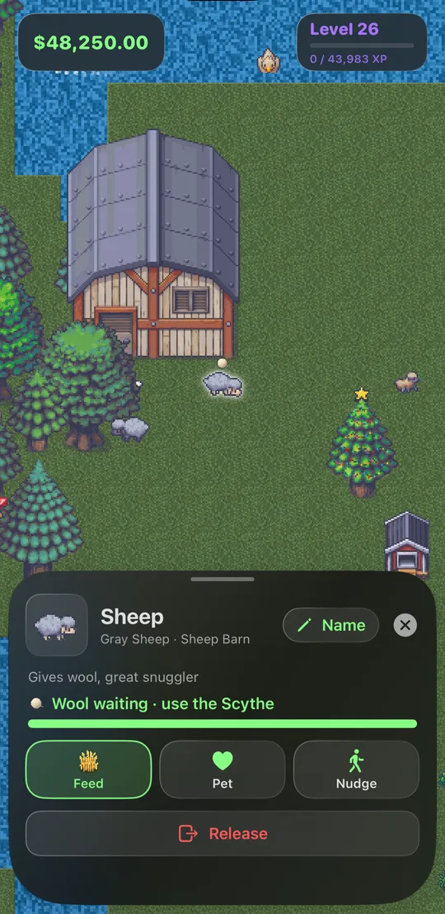
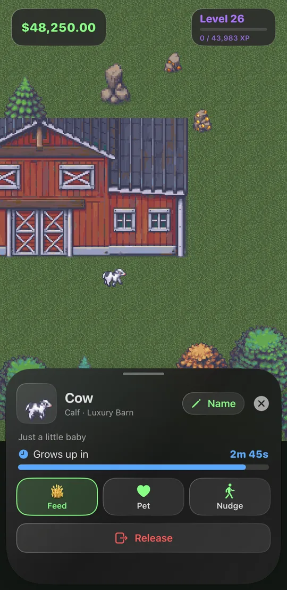

import Fact from '../../../components/Fact.astro';

Tapping an animal opens a small menu that fits its contents.

- The farm stays in view above the menu.
- The animal has a soft white glow ring that follows it as it walks. Closing the menu removes the ring.

If the Harvest tool in hand is the one that collects what the animal has ready, tapping the animal collects it and opens no menu. Eggs lie on the ground and are not collected from the hen: tapping a hen always opens her menu, and an egg beside her is taken with the Bucket (see [Chickens and Eggs](../chickens-and-eggs/#collecting-eggs)).

## What the menu shows

| Part | What it shows |
| --- | --- |
| Name row | The animal's name, then its color or baby name and its home, such as "Black Spotted Cow · Luxury Barn". |
| Name or Rename | A pencil button. It says Name while the animal still has its kind's plain name, and Rename once you have given it one. |
| Personality line | One short line of text for each kind of animal. |
| Status line | What the animal is waiting for, with a bar (see below). Not every animal has one. |
| Feed, Pet, Nudge | Three buttons in a row. |
| Sell or Release | A red button at the bottom. It asks first. |

## Personality lines

| Animal | Line |
| --- | --- |
| Any baby | Just a little baby |
| Cat or dog | Your furry friend, instantly grows crops sometimes |
| Hen | Lays eggs wherever she pleases |
| Rooster | Doesn't lay eggs, he cool though |
| Duck | Guardian of the lake, keeps fish in line |
| Cow | Makes milk, can't read |
| Pig | Fertilizes crops, is a cop |
| Sheep | Gives wool, great snuggler |
| Donkey | Poops on your crops, complains |
| Goat | Makes milk, steals your girl |
| Rabbit | Fertilizes crops, hops on your grave |

## Status line

Animals that grow up or make something show one line with a bar under it.

| State | Line | Bar |
| --- | --- | --- |
| Baby | Grows up in a time such as 12m 40s | Blue, filling as it grows |
| Grown animal making something | Next milk in a time such as 2m 40s | Blue, filling toward the item |
| Hen | Next egg in about a time | No bar, because eggs arrive at random |
| Item ready | The item, "waiting · use the" and the tool, such as "Milk waiting · use the Bucket" or "Wool waiting · use the Scythe" | Green and full, and the line is green |
| Well Fed | The same line, with a bolt beside the timer. A meal by hand or from a crop the animal ate gives it. | Purple, with small arrows moving along it |

Cats, dogs, roosters and grown ducks have no status line, only the personality line.

## Buttons

| Button | What it does |
| --- | --- |
| Feed | Opens a list of the foods in storage, favorite first. See [Feeding](../feeding/). Cats, dogs and grown ducks have no Feed button, but you can still drag food onto them. |
| Pet | Three hearts float up over the animal and it makes its sound. It keeps walking or resting the way it was. |
| Nudge | The animal walks somewhere else. |

Feed shows Wheat (Salmon for cats and dogs) and lights up green when food is stored. While the animal is Well Fed it shows the time left on the meal, such as 4:50. With no food in storage it says No Food.

## Sell and Release

- Ducks and ducklings show **Sell** with the price (<Fact path="animals.livestock.duck.salePrice" as="money" />). See [Ducks](../ducks/).
- Every other animal shows **Release**. It leaves the farm for no money or XP. Its home grows a replacement baby in its own time.
- Both buttons ask first, such as "Sell Duck for <Fact path="animals.livestock.duck.salePrice" as="money" />?" or "Release Chicken?". An animal you named, and any pet, also gets the line "Name will leave the farm for good."
- Releasing a pet leaves its Pet House empty until you choose a new pet. See [Pets](../pets/).

## Related pages

- [Feeding](../feeding/)
- [Animals](../)
