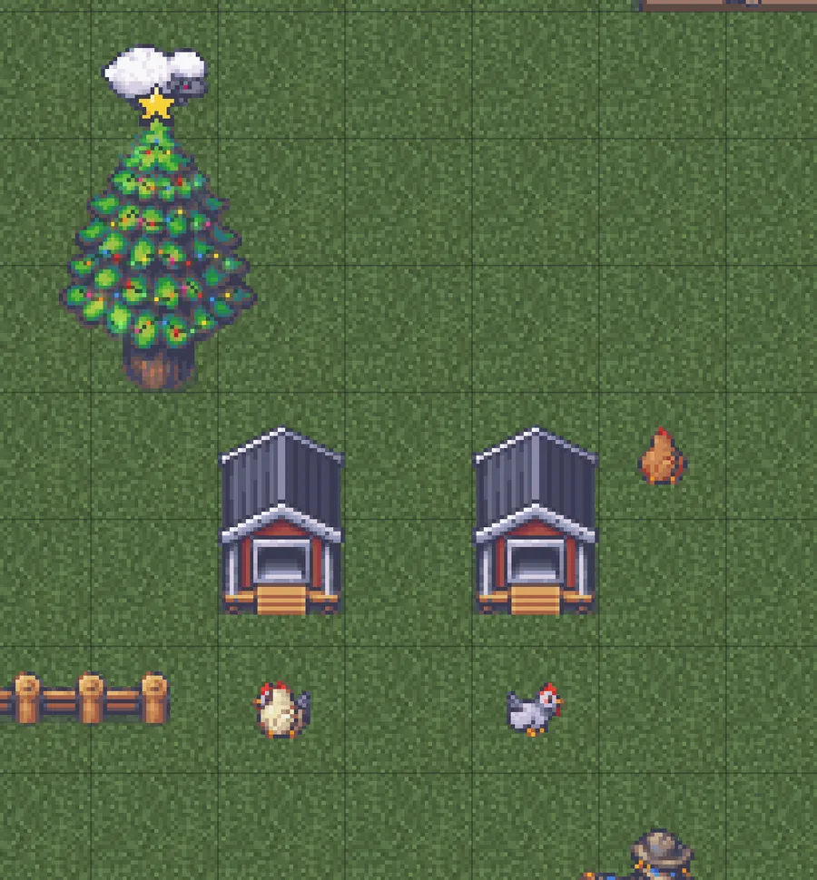

import Infobox from '../../../components/Infobox.astro';
import Fact from '../../../components/Fact.astro';
import Sprite from '../../../components/Sprite.astro';

The Chicken Coop hatches chicks. Chicks grow into chickens, and hens lay eggs on the ground that you collect with the Bucket.

<Infobox kind="building" id="chickenCoop" />

| Chick | Hen | Egg |
| --- | --- | --- |
| <Sprite path="animals.chickens.chickIcon" alt="A chick" /> | <Sprite path="animals.chickens.icon" alt="A hen" /> | <Sprite path="animals.chickens.eggIcon" alt="An egg" /> |

## At a glance

| | Value |
| --- | --- |
| First chick | At once, when the coop is built |
| Next chick | Every <Fact path="animals.chickens.hatchSeconds" as="duration" />, up to what the coop holds |
| Chick grows up in | <Fact path="animals.chickens.growSeconds" as="duration" /> (<Fact path="animals.meal.speedUpPercent" />% faster while Well Fed) |
| A hen lays | About every <Fact path="animals.chickens.layEverySeconds" as="duration" /> on average, at random |
| Eggs waiting per hen | At most <Fact path="animals.chickens.eggsWaitingPerHen" /> |
| An egg sells for | <Fact path="animals.chickens.eggValue" as="money" /> |
| XP per egg | 6 (the coop's unlock level plus one) |
| Coops allowed | <Fact path="buildings.chickenCoop.limit" /> |

## Hatching

- A coop holds <Fact path="buildings.chickenCoop.holds" /> chickens at first and <Fact path="buildings.chickenCoop.holdsFullyUpgraded" /> fully upgraded (see [Animal Homes](../../buildings/animal-homes/)).
- A full coop stops hatching. Its timer starts again when a chicken leaves, so the next chick comes <Fact path="animals.chickens.hatchSeconds" as="duration" /> after that.
- Chicks hatch while the game is closed too, on the tile in front of the coop.
- Chickens follow their coop when it is moved. Destroying the coop removes them.

## Hens and roosters

- By default each chick grows into a hen of a random color, each of the seven equally likely: <Fact path="animals.chickens.henColors" />.
- A coop can be set to hatch only one hen color, or one of seven rooster colors. The choice moves with the coop. Chickens already hatched keep their look.
- Roosters lay no eggs. Apart from that they behave like hens, and they eat crops too.

## Laying

- Each second a grown hen is outside, she has a 1 in 180 chance of laying (1 in 144 while Well Fed). That makes an average of <Fact path="animals.chickens.layEverySeconds" as="duration" /> between eggs, but any wait is possible.
- She lays on the ground where she is walking, a little off the middle of the tile.
- A hen with an uncollected egg lays no more until it is collected.
- Chicks, roosters and hens inside the coop at night or in heavy rain lay nothing.
- Hens lay only while the game is open.

## Collecting eggs

- Only the Bucket collects an egg. Any other tool, or an empty hand, is told to use the Bucket. The Scythe still cuts a crop on the same tile.
- The egg goes to Storage, or sells at once when the Bucket is set to Sell. A full Storage leaves it on the ground.
- A Bucket upgrade gives a chance of a second egg, with no extra XP (see [Tools](../../tools/)).
- An egg blocks its tile: nothing can be planted, built, fertilized or set down there, no terrain can be laid there, and no wild tree or rock grows there.
- Eggs never spoil and stay until collected. A moved coop's eggs stay where they lie.

## Selling and releasing

Chickens cannot be sold. A released chicken leaves for good, for no money or XP, and the coop hatches a replacement in its own time.

## Related pages

- [Animals](../)
- [Animal Homes](../../buildings/animal-homes/)
- [Feeding](../feeding/)
