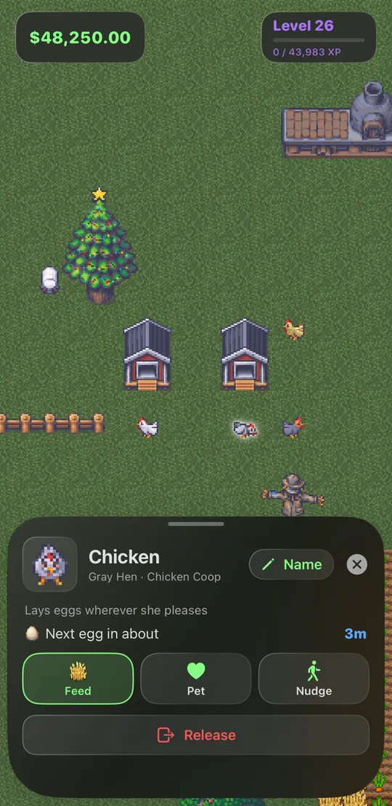

import Infobox from '../../../components/Infobox.astro';
import Fact from '../../../components/Fact.astro';
import Sprite from '../../../components/Sprite.astro';

The Chicken Coop hatches chicks. Chicks grow into chickens, and hens lay eggs on the ground that you collect with the Bucket.

<Infobox kind="building" id="chickenCoop" />

| Chick | Hen | Egg |
| --- | --- | --- |
| <Sprite path="animals.chickens.chickIcon" alt="A chick" /> | <Sprite path="animals.chickens.icon" alt="A hen" /> | <Sprite path="animals.chickens.eggIcon" alt="An egg" /> |

## Hatching

- A new coop hatches its first chick at once in front of itself.
- It then hatches one more every <Fact path="animals.chickens.hatchSeconds" as="duration" />, up to the number the coop holds. See [Animal Homes](../../buildings/animal-homes/) for upgrades that raise it.
- A full coop stops hatching and starts its timer again when a chicken is released.
- Chicks hatch while the game is closed too.
- The coop's menu shows how many chickens it holds and the time until the next chick.
- Chicks and chickens follow the coop when you move it. Demolishing the coop removes them.

## Growing up

- A chick grows into its adult in <Fact path="animals.chickens.growSeconds" as="duration" />. A fed chick grows <Fact path="animals.meal.speedUpPercent" />% faster.
- The chick menu shows the time left.
- Hens come in these colors: <Fact path="animals.chickens.henColors" />.

## Hens and roosters

By default each chick grows into a hen of a random color. In the coop's menu, **Choose Next Chick** picks what future chicks grow into:

- **Random Hen** is the default.
- Any one of the seven hen colors.
- Any one of the seven rooster colors. Roosters are for looks only and lay no eggs.

The choice saves with the coop and moves with it. Chickens you already have keep their look.

## Eggs

- A grown hen (never a chick) lays an egg about every <Fact path="animals.chickens.layEverySeconds" as="duration" /> while she is out and about. She lays it on the ground where she is walking.
- Each hen has at most <Fact path="animals.chickens.eggsWaitingPerHen" /> egg waiting. She lays no more until you collect it.
- A fed hen lays <Fact path="animals.meal.speedUpPercent" />% more often for the length of her meal. See [Feeding](../feeding/).
- An egg sells for <Fact path="animals.chickens.eggValue" as="money" />.
- Hens lay no eggs while sheltering at night or in heavy rain. See [Animals](../#night-and-rain).

### Collecting eggs

1. Pick the Harvest tool and set it to the Bucket (see [Tools](../../tools/)).
2. Tap the egg, or drag the Bucket over it. Holding a finger on it works too.
3. The egg goes to storage, or is sold at once if the Bucket is set to Sell. If storage is full you get a storage-full message.

Eggs are ground items, gathered like a ripe crop.

- A tap beside a hen goes to the egg when the finger is nearer the egg than the hen's middle. Tap the hen herself to open her menu. Tapping a hen never collects an egg.
- Only the Bucket collects an egg. Any other tool, or an empty hand, tapped or held on an egg says "Use the Bucket from the Harvest tool to collect eggs". The Scythe still cuts a crop on the same tile.
- Nothing can be planted, built, fertilized or set down on an egg's tile, and terrain or water cannot be laid there. Dragging across it skips that tile.
- Wild trees and rocks do not grow on an egg's tile.

## Chickens in the menu

Tap a chicken to open its [menu](../animal-menu/). A hen's line says "Next egg in about" a time, or turns green with "Egg waiting · use the Bucket" when an egg lies uncollected. Chickens cannot be sold. **Release** sends one away for no money or XP, and the coop hatches a replacement in its own time.

## Related pages

- [Animals](../)
- [Animal Homes](../../buildings/animal-homes/)
- [Feeding](../feeding/)
