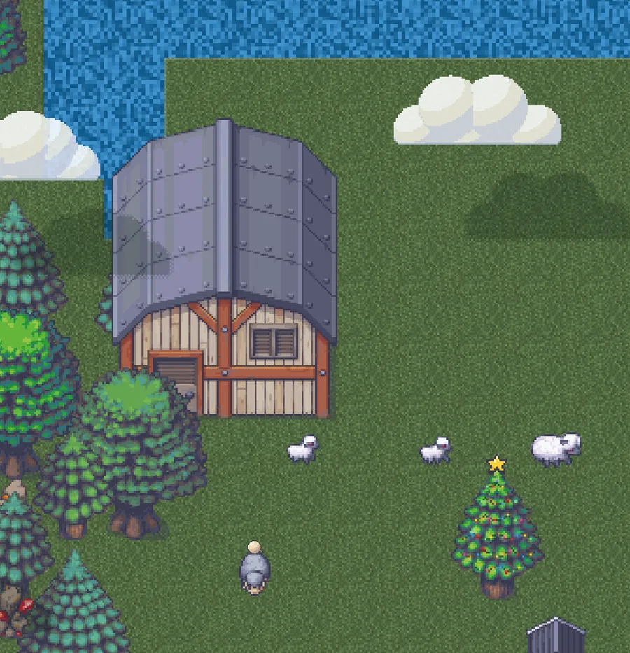

import DataTable from '../../../components/DataTable.astro';
import Infobox from '../../../components/Infobox.astro';
import Fact from '../../../components/Fact.astro';

Livestock are the farm animals that live in barns and similar homes: rabbits, sheep, goats, pigs, donkeys and cows. Each home holds one kind. Ducks are on [Ducks](../ducks/) and chickens on [Chickens and Eggs](../chickens-and-eggs/).

<DataTable name="livestock" />

## Births

| Home | A new baby every |
| --- | --- |
| Rabbit Hutch | <Fact path="animals.livestock.rabbit.birthSeconds" as="duration" /> |
| Sheep Barn | <Fact path="animals.livestock.sheep.birthSeconds" as="duration" /> |
| Goat Barn | <Fact path="animals.livestock.goat.birthSeconds" as="duration" /> |
| Pig Barn | <Fact path="animals.livestock.pig.birthSeconds" as="duration" /> |
| Stable | <Fact path="animals.livestock.donkey.birthSeconds" as="duration" /> |
| Luxury Barn | <Fact path="animals.livestock.cow.birthSeconds" as="duration" /> |

- A new home has its first baby at once, then one more at its own pace until it is full.
- A full home has no more babies. Its timer starts again when an animal leaves.
- A baby appears on the tile in front of the home, or the nearest free tile, and walks out from there.
- Each baby gets a random color, each equally likely (see the table below).
- How many each home holds, and its upgrades, are on [Animal Homes](../../buildings/animal-homes/).

## Growing up and giving

1. A baby grows up in its "Grows up in" time, <Fact path="animals.meal.speedUpPercent" />% faster while Well Fed.
2. Its first item is ready one "Every" time after it grows up.
3. It holds one item at a time. A ready item waits as long as it takes you to collect it.
4. The next countdown starts the moment you collect.

- A meal speeds the countdown only until the item is ready. Time Well Fed with an item waiting is not saved toward the next one.
- Births, growth and items carry on while the game is closed, caught up for at most <Fact path="animals.herdCatchUpDays" /> days.

## Collecting

<DataTable name="animal-produce-xp" where="livestockOnly" is="true" />

- Each item earns the unlock level of the home that makes it plus one, in XP (none at the top level).
- Use the right tool on the animal. Any other tool is told which one to use.
- The item goes to Storage, or sells at once when the tool is set to Sell. A full Storage leaves it on the animal.
- A Scythe or Bucket upgrade gives a chance of a second item, with no extra XP (see [Tools](../../tools/)).
- Animals inside at night or in heavy rain cannot be milked or shorn.
- A sheared sheep has no wool until its next fleece is ready.
- Fertilizer can be spread from Storage (see [Fertilizer and Sprinklers](../../farming/fertilizer-and-sprinklers/)).

## Colors

<DataTable name="animal-colors" />

## The animals

### Rabbit

<Infobox kind="livestock" id="rabbit" />

### Sheep

<Infobox kind="livestock" id="sheep" />

### Goat

<Infobox kind="livestock" id="goat" />

### Pig

<Infobox kind="livestock" id="pig" />

### Donkey

<Infobox kind="livestock" id="donkey" />

### Cow

<Infobox kind="livestock" id="cow" />

## Nighttime UFO visits

On rare clear nights, a UFO saucer can visit a farm that has at least one grown cow without Cosmic Shimmer.

- **When:** clear nights (no rain) between 9 PM and 3 AM on the farm's clock, rolled at most once per night.
- **Odds:** 1 in 20 eligible nights (5%) with no Cosmic cows on the farm. Each Cosmic cow already owned lowers the odds further (1 in 40 with one, 1 in 60 with two, and so on).
- **Zero loss:** the UFO beams one eligible grown cow up for the night while it stays in its herd, then returns it safely at 6 AM the next morning.
- **Cosmic Shimmer:** a returned cow gains a permanent Cosmic Shimmer coat and yields 2× milk (2 cans per milking). A Bucket upgrade can still roll one extra Milk on top.

## Releasing

Livestock cannot be sold. A released animal leaves for good, for no gold or XP, and its home has a replacement baby in its own time.

## Related pages

- [Animals](../)
- [Animal Homes](../../buildings/animal-homes/)
- [Feeding](../feeding/)
