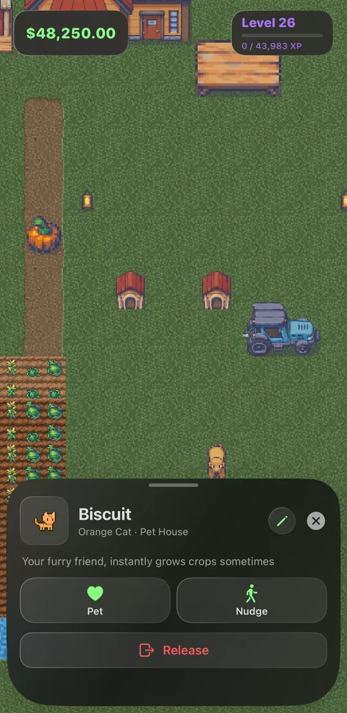

import Infobox from '../../../components/Infobox.astro';
import Fact from '../../../components/Fact.astro';
import DataTable from '../../../components/DataTable.astro';

Pets are cats and dogs. Each lives in its own Pet House. They give nothing to collect, but a pet standing on a growing crop may ripen it.

<Infobox kind="building" id="petHouse" />

## Pet House

- A Pet House holds one pet and is free to build apart from its materials.
- You can place up to <Fact path="buildings.petHouse.limit" /> Pet Houses, one for each pet below.
- It needs plain ground in front of it (grass, farmland or a crop). No building, water or fence can be there.
- A pet appears on the tile in front of its house and follows the house when you move it. Demolishing the house removes the pet.
- Tap a house with a pet to see who lives there. A dog is shown asleep in a doghouse. **Summon** brings the pet back to the front of its house.

## Choosing a pet

An empty Pet House asks "Who will live in this house?". Fill in the form, then tap **OK**:

1. **Pet**: Cat or Dog.
2. **Breed**: for a cat, its color. For a dog, its breed, then a **Color** for that breed.
3. **Name**: type a name. Left blank, the pet gets its breed's name.

Every cat and dog is available from the start.

<DataTable name="pets" />

Dog breeds are <Fact path="animals.pets.dogBreeds" />, each in three colors.

## What pets do

- Pets wander on grass and farmland with no limit on how far from their house they go. Fences, water and buildings hold them in. See [Animals](../#moving-around).
- A pet standing on a growing crop (never a fruit tree) may rarely ripen it. The longer it stays on the crop, the likelier it is. A fed pet is <Fact path="animals.meal.speedUpPercent" />% more likely to do it. Pets indoors at night or in rain do not.
- Tap a pet to open its [menu](../animal-menu/): **Pet** floats three hearts over it and plays its sound (a cat trills and a dog barks), **Nudge** sends it somewhere else, and you can name it.
- Pets can be fed any food by dragging it onto them. Their favorite is <Fact path="animals.meal.petFavorite" />. See [Feeding](../feeding/).
- Pets leave crops alone. They do not eat them.

## Releasing a pet

- **Release** in a pet's menu asks first ("Release Name?" and "Name will leave the farm for good."). The pet leaves for no money or refund.
- Its Pet House stays empty. Open it and choose a new pet the same way as the first.

## Related pages

- [Animals](../)
- [Animal Menu](../animal-menu/)
- [Feeding](../feeding/)
- [Buildings](../../buildings/)
