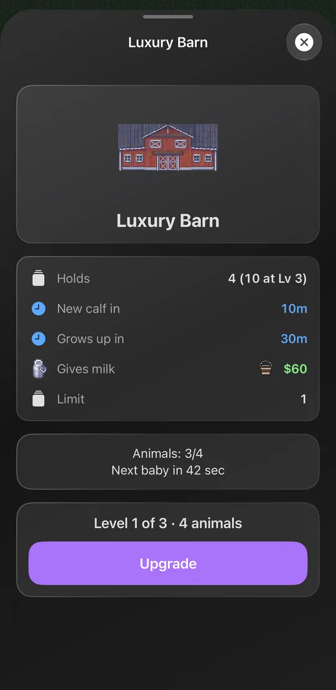

import DataTable from '../../../components/DataTable.astro';
import Fact from '../../../components/Fact.astro';

An animal home holds a group of farm animals. New babies are born in the home until it is full. The animals themselves are covered on the [Animals](../../animals/) pages.

## Homes

| Home | Animals | Unlocks at level | Size (tiles) | Holds | Holds when fully upgraded |
| --- | --- | --- | --- | --- | --- |
| Chicken Coop | Chickens | <Fact path="buildings.chickenCoop.unlockLevel" /> | <Fact path="buildings.chickenCoop.width" />×<Fact path="buildings.chickenCoop.height" /> | <Fact path="buildings.chickenCoop.holds" /> | <Fact path="buildings.chickenCoop.holdsFullyUpgraded" /> |
| Rabbit Hutch | Rabbits | <Fact path="buildings.rabbitHutch.unlockLevel" /> | <Fact path="buildings.rabbitHutch.width" />×<Fact path="buildings.rabbitHutch.height" /> | <Fact path="buildings.rabbitHutch.holds" /> | <Fact path="buildings.rabbitHutch.holdsFullyUpgraded" /> |
| Sheep Barn | Sheep | <Fact path="buildings.barn1.unlockLevel" /> | <Fact path="buildings.barn1.width" />×<Fact path="buildings.barn1.height" /> | <Fact path="buildings.barn1.holds" /> | <Fact path="buildings.barn1.holdsFullyUpgraded" /> |
| Goat Barn | Goats | <Fact path="buildings.goatBarn.unlockLevel" /> | <Fact path="buildings.goatBarn.width" />×<Fact path="buildings.goatBarn.height" /> | <Fact path="buildings.goatBarn.holds" /> | <Fact path="buildings.goatBarn.holdsFullyUpgraded" /> |
| Pig Barn | Pigs | <Fact path="buildings.pigBarn.unlockLevel" /> | <Fact path="buildings.pigBarn.width" />×<Fact path="buildings.pigBarn.height" /> | <Fact path="buildings.pigBarn.holds" /> | <Fact path="buildings.pigBarn.holdsFullyUpgraded" /> |
| Stable | Donkeys | <Fact path="buildings.stable1.unlockLevel" /> | <Fact path="buildings.stable1.width" />×<Fact path="buildings.stable1.height" /> | <Fact path="buildings.stable1.holds" /> | <Fact path="buildings.stable1.holdsFullyUpgraded" /> |
| Luxury Barn | Cows | <Fact path="buildings.barn2.unlockLevel" /> | <Fact path="buildings.barn2.width" />×<Fact path="buildings.barn2.height" /> | <Fact path="buildings.barn2.holds" /> | <Fact path="buildings.barn2.holdsFullyUpgraded" /> |

- Each home holds one kind of animal. There is one of each, except the Chicken Coop, which allows <Fact path="buildings.chickenCoop.limit" />.
- The Pet House holds one cat or dog. See [Pets](../../animals/pets/).
- Costs and materials are in the [Buildings](../) table.
- The Luxury Barn comes in four colors, picked before it is built.
- A home sends its animals out onto the tile in front of it. That tile must stay free (see [Placing and moving](../placing-and-moving/)).
- At night the windows of the barns and the Rabbit Hutch glow, and so do the Stable's stalls and the doorways of the Chicken Coop and Pet House.

## Upgrades

A home starts at Level 1 and can be upgraded to Level 2 and then Level 3. Each upgrade holds more animals. An upgrade unlocks at its own player level and costs money only.

<DataTable name="home-upgrades" />

To upgrade:

1. Tap the home to open its menu.
2. The menu shows its level and how many animals it holds, for example "Level 1 of 3".
3. Tap the purple Upgrade button. A page shows what the next level gives and costs.
4. Tap Upgrade with the price to buy it.

Until the unlock level is reached, the menu shows the level needed in place of the button. A home at Level 3 reads "Fully upgraded". A home keeps its level when it is moved.
