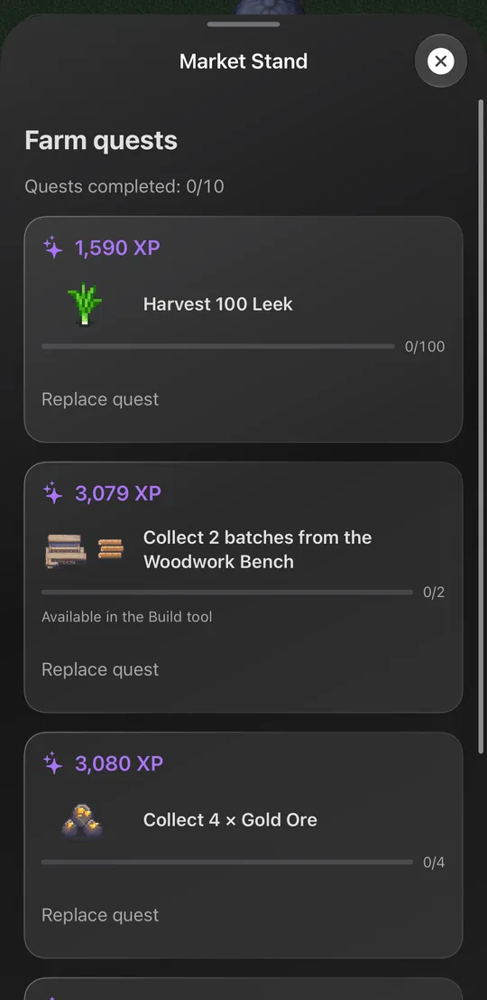

import Fact from '../../../components/Fact.astro';
import Infobox from '../../../components/Infobox.astro';

The Market Stand offers optional quests that pay XP. See [Quests](../../quests/) for how quests work.

<Infobox kind="building" id="marketStand" />

- Only one Market Stand can be built, in either form.
- Tapping the stand opens its menu, which lists its quests under Farm quests.
- The stand shows <Fact path="buildings.marketStand.quests" /> quests at once.

## Upgrade

The upgraded stand is larger and shows more quests at once. Its quests are harder, two-part tasks that pay more XP.

| | Market Stand | Upgraded stand |
| --- | --- | --- |
| Size (tiles) | <Fact path="buildings.marketStand.width" />×<Fact path="buildings.marketStand.height" /> | <Fact path="home-upgrades.marketStand.width" />×<Fact path="home-upgrades.marketStand.height" /> |
| Quests at once | <Fact path="home-upgrades.marketStand.questsBefore" /> | <Fact path="home-upgrades.marketStand.questsAfter" /> |

- The upgrade needs <Fact path="home-upgrades.marketStand.questsNeeded" /> completed quests. The menu shows "Quests completed" with the count until then.
- It costs <Fact path="home-upgrades.marketStand.cost" as="money" />. It needs no logs, stones or level.
- The larger stand needs free ground for its size. If there is no room, move the stand first (see [Placing and moving](../placing-and-moving/)).
- The stand keeps its current quests and progress.

To upgrade:

1. Tap the stand.
2. Tap the purple Upgrade button, which appears once enough quests are completed.
3. Tap Upgrade with the price on the page that opens.
