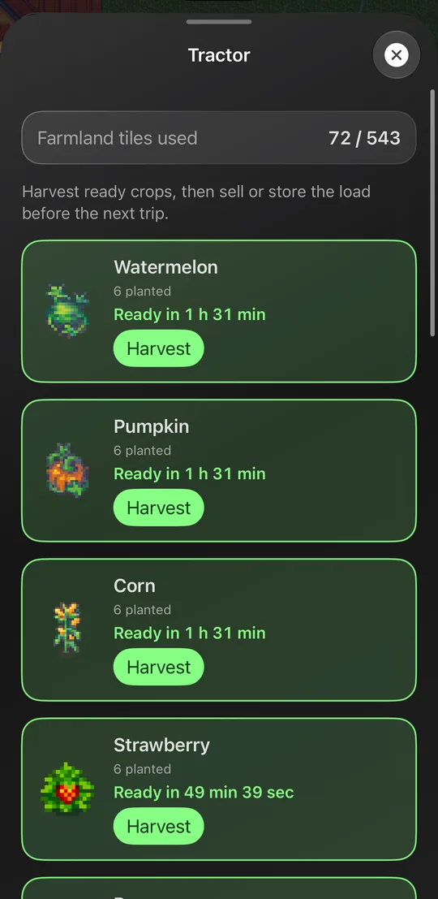

import Fact from '../../../components/Fact.astro';
import Infobox from '../../../components/Infobox.astro';

The Tractor drives out, harvests ripe crops and brings them home.

<Infobox kind="building" id="tractor1" />

## Looks

The Tractor faces one of four ways: <Fact path="buildings.tractor1.styles" />. The look is picked before it is built.

- Facing Right or Left, it covers 2×1 tiles. Facing Front or Back, it covers 1×2 tiles.
- It drives out from the front. A parked Tractor reserves both of its tiles.
- Animals standing in its way are moved aside.

## Crop overview

Tapping the Tractor, with any tool, opens its crop overview.

- The top row shows farmland tiles used out of the limit unlocked so far.
- Below it is a list of every crop and fruit tree currently planted, and every crop the Tractor carries.
- The crop that pays the most for each plant comes first.
- Each row shows how many are planted and either "Ready to harvest" or the time until the slowest one is ready.

## Harvesting

1. Tap the Tractor.
2. Tap Harvest on a crop that has plants fully grown.
3. The menu closes and the Tractor drives to each ripe plant of that crop, one after another.
4. When it has taken them all it drives home.

- It takes only the plants that are fully grown and leaves the rest.
- One crop is harvested per trip.
- It cannot harvest fruit trees.
- The Tractor drives only while the game is open.
- Tap the Tractor while it is harvesting and tap Cancel to send it home with what it has.
- If it cannot reach the remaining crops, it goes home. If it cannot reach home, it stops where it is and that spot becomes its home.

## Unloading

Gathered crops are carried in the Tractor, not in storage. Each row in the overview shows how many are gathered, with Store and Sell buttons.

- Store moves as many as fit into storage and leaves the rest aboard.
- Sell sells the whole load at the usual price.
- The Scythe unloads the Tractor too. It stores the load, or sells it when the Scythe is set to Sell.
- Unloading works at any time, even while the Tractor is driving.
- The XP for the crops is earned when they are stored or sold.
- A new trip cannot start until the load is fully unloaded.

## Moving and destroying

- A Tractor cannot be moved or destroyed while it is driving.
- A Tractor with a load cannot be destroyed until it is unloaded.

See [Placing and moving](../placing-and-moving/).
