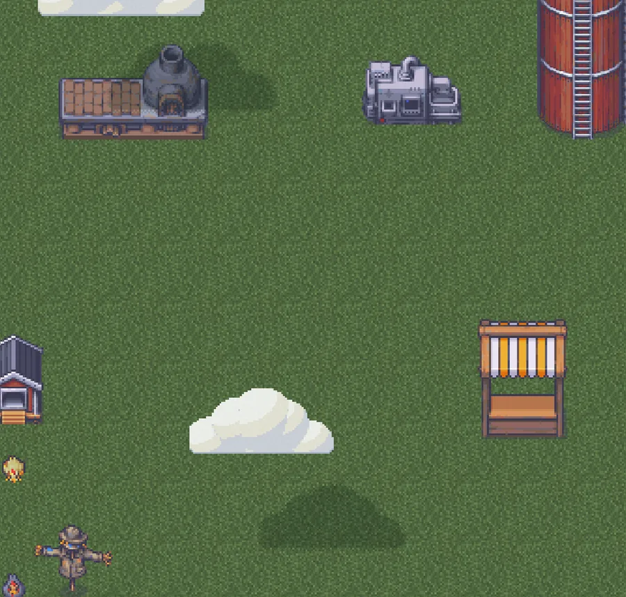
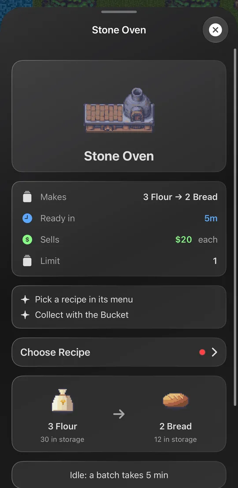

import Fact from '../../../components/Fact.astro';

A workshop takes goods from storage, works for a while and gives back something worth more. Every recipe is listed on [Crafting](../../crafting/).

## Workshops

| Workshop | Unlocks at level | Makes |
| --- | --- | --- |
| Grain Machine | <Fact path="buildings.grainMachine.unlockLevel" /> | Flour, Watermelon Juice, Grape Juice |
| Stone Oven | <Fact path="buildings.stoneOven.unlockLevel" /> | Bread, preserves, bars, Turnip Soup, Pumpkin Pie, Roasted Coffee |
| Woodwork Bench | <Fact path="buildings.woodworkBench.unlockLevel" /> | Planks, Furniture |
| Tailor Table | <Fact path="buildings.tailorTable.unlockLevel" /> | Cloth, Fine Cloth |
| DIY Crafting Table | <Fact path="buildings.diyTable.unlockLevel" /> | Bricks, polished gems, Radish Pickles |
| Dairy | <Fact path="buildings.dairy.unlockLevel" /> | Cheese, Goat Cheese |
| Cheese Cellar | <Fact path="buildings.cheeseCellar.unlockLevel" /> | Aged Cheese |

Costs and sizes are in the [Buildings](../) table.

## Making a batch

1. Tap the workshop to open its menu.
2. If the workshop has more than one recipe, tap Choose Recipe and pick one. A recipe that is still locked shows the level it unlocks at.
3. The menu shows what goes in, what comes out and how many of the ingredient are in storage.
4. Tap Start. The ingredients are taken from storage and the workshop starts working.

- A workshop makes one batch at a time.
- The menu reads "Idle", "Working" with the time left, or "Finished".
- Work continues while the game is closed.
- Start is greyed out until storage holds enough of the ingredient. Tapping it says how many are needed.
- A recipe cannot be changed while the workshop is working or has a finished batch waiting.
- The first recipe of a workshop is available as soon as the workshop is. The other recipes unlock at their own level.

## Collecting

A finished workshop changes to a picture that shows it full. Collect with the Bucket from the Harvest tool: drag it over the workshop or tap the workshop with the Bucket in hand.

- The goods go into storage, or are sold at once when the Bucket is set to Sell. See [Storage and selling](../../storage-and-selling/).
- If storage has no room, the goods stay in the workshop and the game says storage is full.
- Any other tool says to use the Bucket.
- A workshop cannot start a new batch until the finished goods are collected.

## Moving and destroying

Moving a workshop keeps its work and its chosen recipe. Destroying a workshop ends any batch in progress. See [Placing and moving](../placing-and-moving/).

The Stone Oven's chimney smokes while it is baking or smelting. The oven's mouth glows at night.
