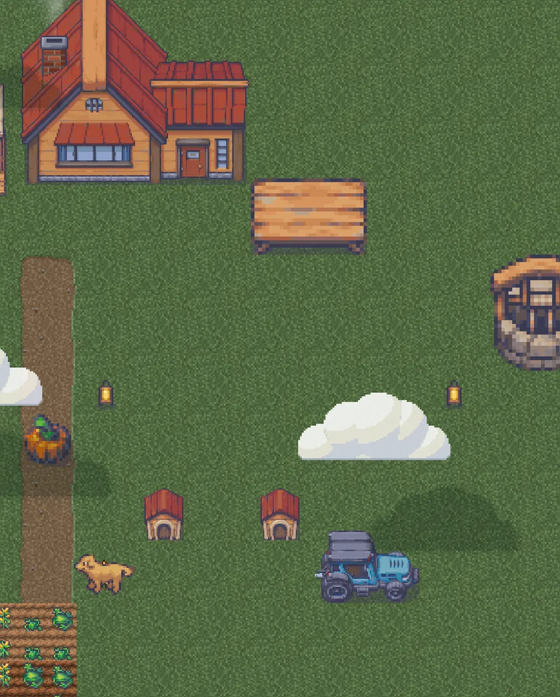

import DataTable from '../../../components/DataTable.astro';
import Fact from '../../../components/Fact.astro';

Decorations are objects that stand on the farm. Most are for show. A few have an effect on crops. They are set down with the Decorate tool, which also places [fences](fences-and-paths/) and [planted trees](planted-trees/).

## Materials, not levels

No level unlocks a decoration. Each one costs money plus materials taken from Storage, such as Logs, Stones, Wheat, Planks or a fish. The Decorate list is ordered by the level at which its materials can first be had. A row that is short of money or materials shows the missing part in red.

- Tapping a row picks the decoration. Tapping or dragging to a tile sets it down with that tile as its bottom left corner.
- Setting one down charges its money and takes its materials from Storage.
- A decoration stands on bare grass. It cannot go on water, farmland, a crop, a fence, a building, a tree or an animal, or in front of the entrance of an animal home.
- Decorations take up their tiles. Animals walk around them.

## All decorations

<DataTable name="decorations" />

Sprinklers are in the Fertilize tool and not in the Decorate list. See [Fertilizer and sprinklers](../farming/fertilizer-and-sprinklers/).

## Looks

Many decorations come in more than one look. After picking one with several looks, a second dropdown beside the tool circle lists them. The chosen look is used for each new one set down. The Looks column of the table shows how many each has.

## Effects

| Decoration | Effect |
| --- | --- |
| Scarecrow | Crops within 3 tiles grow 5% faster |
| Sprinkler | Waters farmland within 2 tiles |
| Big Sprinkler | Waters farmland within 3 tiles |

The Scarecrow bonus adds to the speed-up from water and from fertilizer. See [Growth](../farming/growth/).

## Limits and special cases

- At most <Fact path="decorations.trunk.limit" /> Trunks can stand on a farm.
- A Rock is set down as a real rock. It is broken with the Pickaxe, which gives no stones from a rock you placed. See [Mining](../gathering/mining/).
- A Lantern opens a menu when tapped. See [Lanterns and lights](lanterns-and-lights/).
- A Christmas Tree stands on one tile at every size. See [Lanterns and lights](lanterns-and-lights/).

## Moving, destroying and storing

| To do this | Do this |
| --- | --- |
| Move a decoration | Hold a finger on it, drag it to a free spot and tap Place. Cancel puts it back. Nudge moves its picture within the tile. |
| Destroy a decoration | Tap it with any tool except the Axe, then confirm. It returns <Fact path="terrain.refundPercent" />% of its price and of each material. |
| Take it down into Storage | Tap it with the Axe. One tap takes it down and puts it in Storage, with its look. Storage needs a free slot. |
| Set a stored decoration | Open Storage and tap Select on its row. The Decorate tool then holds it, and each one set down uses one from Storage and costs no money. |
| Sell a stored decoration | Sell it from Storage for <Fact path="terrain.refundPercent" />% of its price. |

A Lantern keeps its light settings when it goes into Storage and comes back with them. A Rock is broken with the Pickaxe and does not go into Storage.

## Related pages

- [Fences and paths](fences-and-paths/)
- [Planted trees](planted-trees/)
- [Lanterns and lights](lanterns-and-lights/)
- [Storage and selling](../storage-and-selling/)
- [Tools](../tools/)
