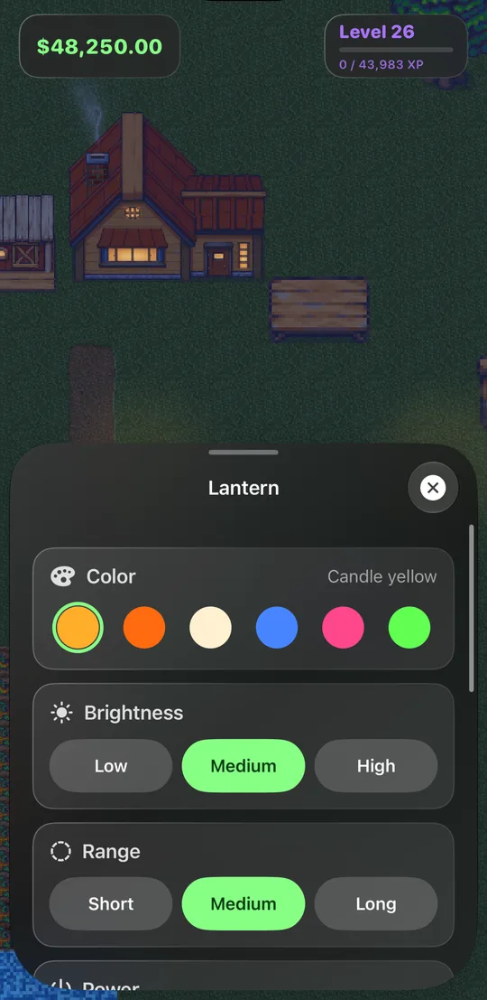
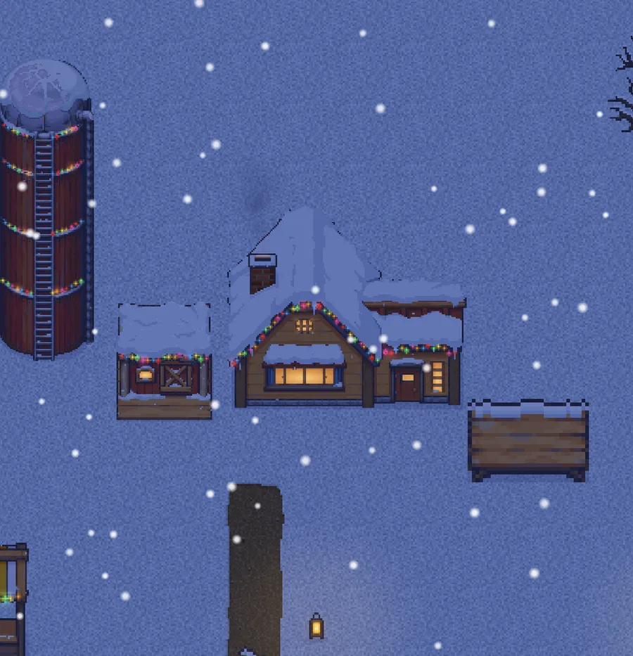

import DataTable from '../../../components/DataTable.astro';
import Fact from '../../../components/Fact.astro';

Some decorations and buildings glow at night and in rain. The glow is a picture effect and does not change any rules.

## Lantern

The Lantern is a one tile decoration in the Decorate list.

<DataTable name="decorations" where="id" is="lantern" />

Tapping a standing Lantern opens its menu. The change shows on the farm at once and costs nothing. Each Lantern keeps its own settings. With the Axe in hand, a tap takes the Lantern down into Storage instead.

| Setting | Choices | What it does |
| --- | --- | --- |
| Color | Candle yellow, Warm amber, Soft white, Pale blue, Rose, Leaf green | The color of the light. It also tints the glass by day. |
| Brightness | Low, Medium, High | How strong the light is. |
| Range | Short, Medium, Long | How far the glow reaches. |
| Power | Auto, Always on, Always off | Auto lights it with the windows at night and in rain. Always on also gives a soft glow by day. Always off never lights it, and the glass looks darker. |
| Effect | Flicker, Steady | Flicker pulses softly like a window. Steady does not. |
| Nudge | A pad of arrows, with Center | Moves the picture inside its tile. The tile and what it blocks stay the same. |

- A new Lantern starts on Candle yellow, Medium brightness, Medium range, Auto and Flicker.
- With Reduce Motion on in the device settings, every Lantern is steady.
- A Lantern keeps its settings when it goes into Storage and comes out again.

The menu also has Destroy, which asks first and returns <Fact path="terrain.refundPercent" />% of the price and materials. See [Decorations](../#moving-destroying-and-storing).

## Christmas Tree

<DataTable name="decorations" where="id" is="christmasTree" />

- It is a pine hung with colored bulbs and a star, in Small, Medium, Big and Huge.
- It stands on one tile at every size, and its picture rises over the tiles behind it, as a planted tree's does.
- At night and in rain its bulbs and star glow, and a few bulbs at a time swell with a soft glow.
- In Winter it shows its snowy look. In every other season it shows the summer one.

## Christmas lights on buildings

String lights hang along the roof edges of these buildings: Pet House, Chicken Coop, Market Stand, Shed, Rabbit Hutch, Sheep Barn, Goat Barn, Pig Barn, Luxury Barn, House, Silo and Stable. The Tractor, the workshops, the Dairy and the Cheese Cellar have none.

- The lights hang in Winter. A setting can hang them in every season.
- The bulbs glow with the windows at night and in rain.
- Settings → Graphics → Christmas Lights sets how they look. See [Settings](../../settings/settings/).

| Setting | Choices | What it does |
| --- | --- | --- |
| Power | Always On, Always Off, Auto | Auto glows at night and in rain. Always On also glows softly by day. Always Off keeps the strands dark. |
| Pattern | Twinkling, Solid | Twinkling lets a few bulbs at a time glow softly. With Reduce Motion on they stay solid. |
| All Year | No, Yes | No hangs the lights in Winter only. Yes hangs them in every season. |

The Pattern setting applies to the Christmas Tree's bulbs as well.

## Lit windows

At night, and as a shower darkens the day, the lit buildings glow warmly.

- Windows light on the House, Sheep Barn, Goat Barn, Pig Barn, Luxury Barn, Shed and Rabbit Hutch.
- Doorways light on the Pet House, Chicken Coop, Stable and Stone Oven, and on the doors of the Silo's shed.
- The Market Stand, Silo tower, Tractor, Dairy, Cheese Cellar and workshops other than the Stone Oven stay dark.
- Every light pulses gently, each at its own pace. With Reduce Motion on, they burn steadily.

See [Day and night](../../world/day-and-night/) and [Weather](../../world/weather/).

## Related pages

- [Decorations](../)
- [Planted trees](../planted-trees/)
- [Seasons](../../world/seasons/)
