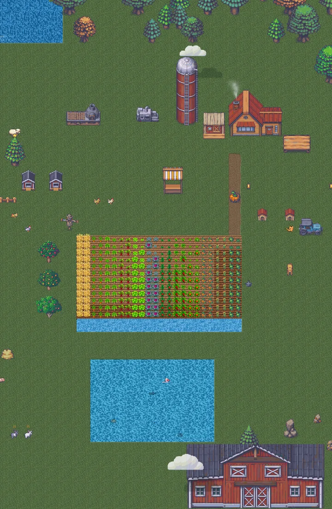

The farm screen shows the whole farm from above, with a few panels and buttons over it.

## Parts of the screen

| Part | Where | What it does |
| --- | --- | --- |
| Money | Top left | Your money. Hidden with Settings → Graphics → Show Money. |
| Level | Top right | Your level, with a bar of the XP toward the next one. Hidden with Settings → Graphics → Show Level. See [Levels](../levels/). |
| Yellow "!" | Between the money and the Level | Appears when an update is available. See [Saves and iCloud](../settings/saves-and-icloud/). |
| Tool circle | Bottom left | The tool in hand. Tap it to open the ring of tools. See [Tools](../tools/). |
| Dropdowns | Beside the tool circle | What the tool holds, such as the crop to plant. Tapping one opens a list above it. |

## Moving around

- Pinch to zoom the farm in or out.
- Drag with one finger to move around it.

## Related pages

- [Tools](../tools/)
- [Settings](../settings/settings/)
