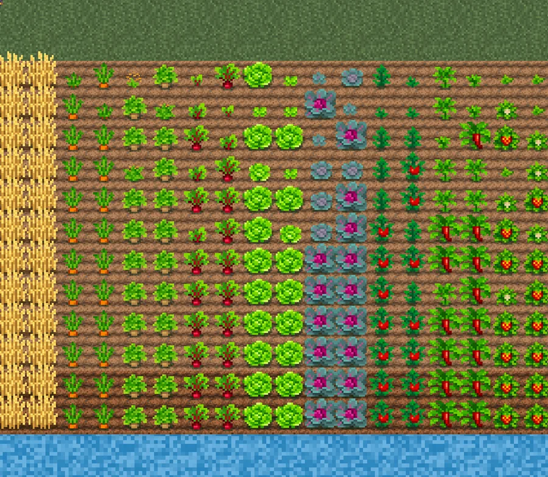

import DataTable from '../../../components/DataTable.astro';
import Fact from '../../../components/Fact.astro';

Crops grow on [farmland](../farmland-and-water/) from seeds and are cut once with the Scythe. Each level unlocks one crop or [fruit tree](../fruit-trees/), from Wheat at level 1 to Coffee at level <Fact path="world.maxLevel" />.

## All crops

<DataTable name="crops" />

- Seed cost is paid for each tile planted. Wheat seeds are free.
- "Sells for" is paid per tile harvested, when it is sold.
- XP is earned for each tile harvested (see [Levels](../../levels/)).
- Grow time is the base time. [Water, fertilizer and a Scarecrow](../growth/) shorten it.

## How prices and times are set

Every crop's numbers follow from its place in the unlock order.

| Rule | Value |
| --- | --- |
| Wheat | Free seed, sells for <Fact path="crops.wheat.sellValue" as="money" />, grows in 10 s |
| Carrot | Set by hand: grows in 30 s, the one crop that does not sell for twice its seed |
| Seed price (Potato on) | Half the sale price, so a harvest pays back twice the seed |
| Grow time (Potato to Blackberry) | Potato takes 1 min. Each crop after it takes about 1.33 times as long as the one before, up to 2 h for Blackberry |
| Grow time (Blackberry on) | 2 h for every crop |
| Gold per minute of growing | 5% more than the crop before, up to Zucchini. 2.5% more for each crop after Zucchini |
| XP | Unlock level plus one (Wheat 1, Carrot 3, Potato 4), whatever the grow time |

Prices are rounded to whole silver, so the earliest crops sit a little off the 5% step.

## Planting

- A crop is planted on farmland with nothing on it: no crop, fertilizer is fine, no decoration, building or egg.
- Only unlocked crops can be planted, and each tile costs the seed price.
- Each tile is one crop, harvested as a whole for one item and one set of XP.
- Each tile shows four small plants that change from sprout to growing to full size at their own moments. The last one finishes exactly when the crop is ripe.

Most planting materials are Seeds (Wheat Seeds, Carrot Seeds). The others are:

| Crop | Planting material |
| --- | --- |
| Potato | Potato Tubers |
| Garlic | Garlic Cloves |
| Asparagus | Asparagus Crowns |
| Red Onion | Red Onion Sets |
| Strawberry | Strawberry Runners |
| Raspberry | Raspberry Canes |
| Blackberry | Blackberry Canes |
| Pineapple | Pineapple Crowns |
| Grapes | Grape Cuttings |
| Prickly Pear | Prickly Pear Pads |

## Harvesting

- Only the Scythe harvests a ripe crop. The tile is empty again afterwards, and its fertilizer is used up.
- With the Scythe on Sell the crop sells at once and needs no storage room. On Store it goes to [Storage](../../storage-and-selling/), which needs one free slot.
- A Scythe upgrade gives a chance of a second crop from the tile (see [Tools](../../tools/)). The second crop earns no XP and is only taken if it fits in Storage.
- The [Tractor](../../buildings/tractor/) can harvest ripe crops for you.
- Destroying a crop removes it for no gold or XP. The seed cost is not refunded, and fertilizer on the tile stays for the next crop.

## Animals and pets

- Grown chickens and farm animals out in the open sometimes eat the crop they stand on (see [Growth](../growth/#animals-eating-crops)).
- A pet standing on a growing crop can make it ripen at once (see [Growth](../growth/#pets-ripening-crops)).
