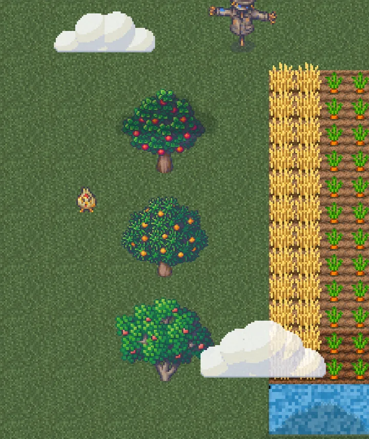

import DataTable from '../../../components/DataTable.astro';
import Fact from '../../../components/Fact.astro';

Fruit trees are planted once and give a basket of fruit again and again. They unlock by level, between the [crops](../crops/).

## All fruit trees

<DataTable name="fruit-trees" />

- Cost is paid once, when the tree is placed. There is no seed to buy again.
- At most <Fact path="fruit-trees.apple.limit" /> trees of each kind can stand on the farm.

## How the numbers are set

A fruit tree sits halfway between the crop before it and the crop after it in the unlock order.

| | Rule |
| --- | --- |
| Basket price | 1.5 times what a crop at the tree's place would sell for |
| Ripening time | 3 times the grow time of the crop that unlocks right after it |
| Cost | 12 baskets' worth |
| XP per basket | 1.5 times what a crop of its level earns (unlock level plus one), rounded |

## Phases

A tree has two looks: bare while it grows, and with ripe fruit when it is ready. It never withers or dies.

1. A new tree starts growing the moment it is placed.
2. When its ripening time is up, it shows ripe fruit and waits, however long it takes you to pick it.
3. Picking it with the Bucket gives one basket (such as an Apple Basket) and its XP, and the tree starts growing again at once.

## Rules

- A tree takes a 2×2 square: its picture covers four tiles and its trunk stands on the bottom two.
- It stands on bare grass only, never on farmland, water, a fence or an animal, and never in front of an animal home.
- Water, fertilizer and a Scarecrow do not speed a tree, since it stands on grass. Seasons and weather do not change it.
- Pets never ripen a tree and animals never eat one.
- Only the Bucket picks fruit. On Sell the basket sells at once. On Store it goes to [Storage](../../storage-and-selling/).
- A Bucket upgrade gives a chance of a second basket, with no extra XP (see [Tools](../../tools/)).
- The Tractor does not pick fruit.
- A moved tree keeps its growth. A destroyed tree gives no money back, and the Axe does not cut it.

## Preserves

Each kind of basket has a preserves recipe in the Stone Oven: <Fact path="recipes.applePreserves.inputCount" /> baskets make one jar. See [Crafting](../../crafting/) for times, levels and prices.

| Tree | Preserves |
| --- | --- |
| Apple Tree | Apple Preserves |
| Orange Tree | Orange Preserves |
| Peach Tree | Peach Preserves |
| Lemon Tree | Lemon Preserves |
| Banana Tree | Banana Preserves |
