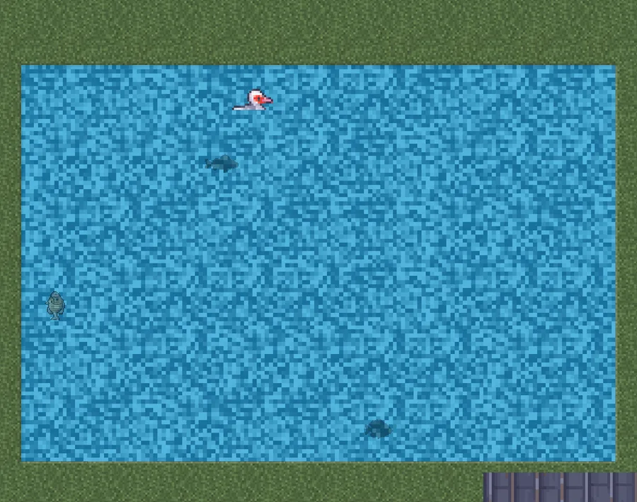

import DataTable from '../../../components/DataTable.astro';
import Fact from '../../../components/Fact.astro';

Fish swim in ponds and are caught with the Fishing Rod, one of the [Harvest implements](../../tools/). A catch is sold on the spot or stored. Every kind of fish is listed on [Fish](../fish/).

## Where fish live

- A body of water can hold fish if it has an interior tile, a water tile with water on all eight sides around it. A 3×3 puddle has one. Water you lay with the Terrain tool counts too.
- A body of water has room for one fish for every 20 interior tiles, rounded up. The whole map has room for at most 15 wild fish.
- New fish appear apart from each other and from ducks. Joined water keeps every fish it had.
- A new farm has 2 or 3 ponds (see [New Farm](../../world/new-farm/)). Each fish place starts with a fish about half the time, and a new farm always has at least one Rare or rarer fish.
- Fish only swim in water. They are not caught by any implement except the Fishing Rod. Holding the Bucket over a fish says to use the Fishing Rod.

## How fish come and go

| Event | What happens |
| --- | --- |
| Pond made | The first fish appears after 10 min |
| Fish caught, given up or swum away | The next fish appears after 30 min |
| Night | The wait shortens as it gets dark, to half at full night (see [Day and Night](../../world/day-and-night/)) |
| Nobody catches a fish | It swims away after one farm day (<Fact path="world.realSecondsPerFarmDay" as="duration" /> of play) |
| A fish is on your line | It never swims away during the fight |

- Each fish place has its own timer. Catching one fish leaves the others alone.
- A fish of a kind you have never caught shows as a dark shadow on the water, drawn bigger for a heavier fish. A fish of a kind you have caught shows faintly as itself.
- A fish swims sideways more often than up or down and stays near where it appeared.
- Fish that you let go (see below) and fish you have named never swim away.

### Which fish appear

A new fish first gets a rarity, then a kind of that rarity with equal chance. Only some rarities bite at low levels.

<DataTable name="rarities" columns="Rarity,Bites from level,Kinds of fish" />

Rarer fish become more likely as you level up. The mix shifts at levels <Fact path="fish.rarityRateLevels" /> and stays put after the last of them.

## Catching a fish

1. Pick the Fishing Rod from the Harvest tool's first dropdown.
2. Tap a fish's shadow, or drag the tool circle over the fish. A tap or drag on water with no fish says "No fish is swimming there; drag the rod over a fish".
3. The pond's water fills the whole screen and the fish swims about it. The Catch Meter shows at the top with the fish's rarity under the bar.
4. Drag the tool circle so the ring at its working point stays over the fish. While the ring is within the catch circle's reach of the fish, the bar fills. When the bar is full, the fish is caught.
5. A catch card shows the fish in the middle of the screen: "King Salmon" (or its own name), with its number small beside its weight ("#5 · 31.0 lb · $311"), its rarity, its weight in pounds, how heavy that is for its kind ("Heavier than 62.0% of this species") and its price. The first fish of a kind you catch has a gold "New!" on the card. Choose **Sell** to take that fish's price at once or **Store** to keep it in [Storage](../../storage-and-selling/).

- A ring shows where the rod works until it is over the fish.
- Tapping the fish while it swims says "Drag the fishing rod over the fish to catch it". Tapping it again soon after shows a finger dragging the tool circle onto the fish.
- The bar drains slowly while the ring is off the fish. The fish is not lost.
- The phone buzzes while the bar fills, faster as it fills.
- Switching apps, locking the phone or a call pauses the fight.
- The bar is green at first, then turns yellow, orange and red as it nears full.
- Storage does not need room to start a cast. If Storage is full, **Store** says so and leaves the fish on show so you can sell it.
- Tapping the tool circle during a fight shows one button, **Exit**. Exit gives the fish up: it leaves the pond for good and the next one takes 30 min. If the fish is already caught and on show, Exit stores it.

### Harder fish

| Rarity | Hold the ring over it for at least |
| --- | --- |
| Common | 2.4 s |
| Uncommon | 3 s |
| Rare | 4.4 s |
| Epic | 5.8 s |
| Legendary | 7 s |

- Rarer fish also swim faster and change direction more often and more sharply.
- Common fish turn least, and sometimes double back.
- The fuller the bar, the harder the fish fights: it swims faster and turns more sharply, up to twice as fast when the bar is nearly full.

### Fishing Rod upgrades

A better Fishing Rod widens the catch circle, the distance the ring can be from the fish and still fill the bar. Upgrades are bought from the Harvest tool's list (see [Tools](../../tools/)).

<DataTable name="tool-upgrades" where="tool" is="Fishing Rod" />

## Weight

- Every fish has a weight in pounds within the range for its kind (see [Fish](../fish/)).
- Most fish are middling. Very light and very heavy ones are rare.
- The weight is set when the fish appears and stays the same.

- Weight changes the XP a catch earns, from half to one and a half times the usual for its kind, and how big the fish is drawn, from 0.8 times to 1.2 times.
- Weight also sets the price: <Fact path="fish.lightestPricePercent" />% of the rarity's price for the lightest fish of a kind, up to <Fact path="fish.heaviestPricePercent" />% for the heaviest. Each kind's price range is on [Fish](../fish/).
- The catch card shows how heavy the fish is for its kind. The percentage is colored by how rare that weight is.

## Your fish

Every caught fish is kept as its own fish.

| Part | What it is |
| --- | --- |
| Number | The fish gets the next number of its kind the first time you catch it, such as "King Salmon #5". |
| Name | The number is its name until you give it one. A name stays with the fish through Storage and back into the water. |
| Weight | Fixed for that fish. It sets its price and size. |

- A fish you let go keeps its weight, number and name. Catching it again earns no XP and does not count in [Progress](../../progress/).

### Fish menu

Tap a fish in a pond with any tool except the Fishing Rod to open its menu. The fish has a white ring while the menu is open.

| Part | What it shows |
| --- | --- |
| Name row | Its name, a rarity chip and who it is: Wild, its number, or its kind and number once named. |
| Weight and price | Such as "23.4 lb · $289". |
| Personality line | One line for each rarity (see below). |
| Stay line | When it swims off, or that it stays because you named it or let it go. |
| Name or Rename | Gives the fish a name of up to 20 characters. A named fish never swims away. |
| Pet | A splash and hearts. |
| Nudge | The fish darts a few tiles. |
| Release | Asks first. The fish leaves the pond for good, for no money or XP. |

| Rarity | Line |
| --- | --- |
| Common | Swims in circles, thinks it's deep |
| Uncommon | Nibbles the bait, judges your cast |
| Rare | Too good for your bait |
| Epic | Fights dirty, holds grudges |
| Legendary | Has seen things, won't say what |

- A fish of a kind you have never caught is greyed out as a silhouette, apart from Pet, which still works. It reads "Unknown fish", "???" and "Catch one to learn more".
- Releasing a fish that appeared by itself starts the same wait as a catch. Releasing one you let go leaves no fish in its place.

## XP for fish

- An average Common fish earns about 1/300 of the XP it takes to leave your level, the same share at every level.
- No XP is earned at the top level.

| Rarity | XP compared with a Common fish |
| --- | --- |
| Common | 1× |
| Uncommon | 2× |
| Rare | 4× |
| Epic | 7× |
| Legendary | 10× |

- The fish's weight then multiplies that by 0.5 to 1.5.
- A catch can level you up. See [Levels](../../levels/).

## Letting a fish go

A stored fish can go back into the water.

1. Open Storage and tap **Select** on a kind of fish to hold its heaviest, or open the kind's row (see [Storage and Selling](../../storage-and-selling/#fish-in-storage)) and tap **Let go** on one fish. The Decorate tool holds it, and its dropdown names the fish.
2. Tap or drag over free water, one fish per tile. Each fish leaves Storage.

- A fish you let go swims like any other and stays until it is caught. It never swims away by itself and is not replaced.
- It does not count against the fish that appear on their own, and there is no limit on how many you let go.
- Catching it again earns no XP and does not count in [Progress](../../progress/).
- Fish can also be fed to animals instead (see [Feeding](../../animals/feeding/)).

## Related

- [Fish](../fish/): every kind, rarity and price
- [Tools](../../tools/): the Fishing Rod and its upgrades
- [Day and Night](../../world/day-and-night/)
