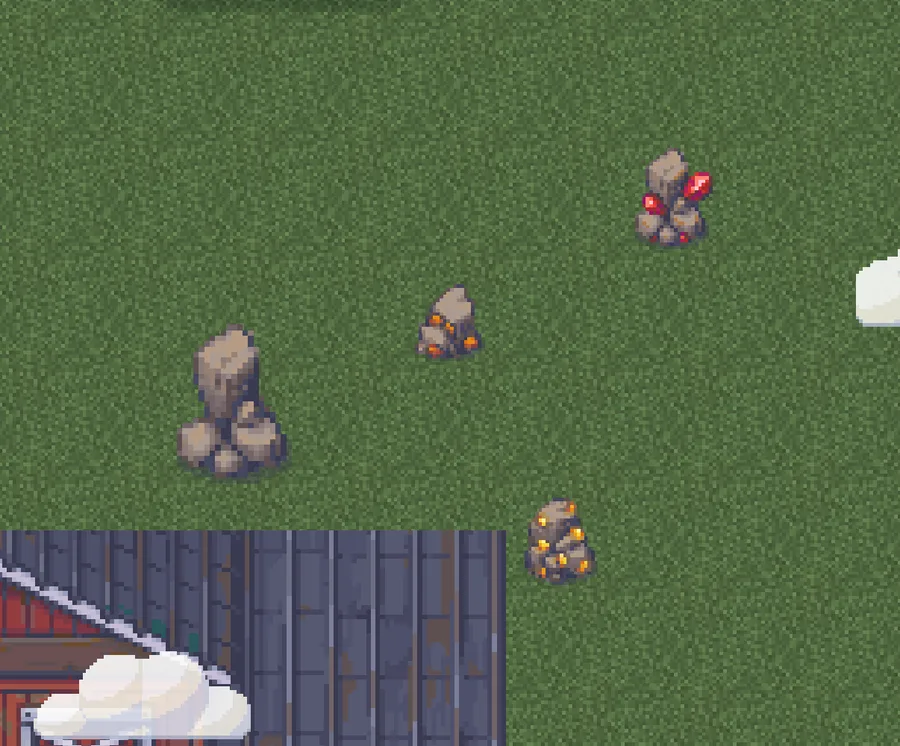

import DataTable from '../../../components/DataTable.astro';
import Fact from '../../../components/Fact.astro';

The Pickaxe, one of the [Harvest implements](../../tools/), breaks rocks into stones and mines ore veins for ore. Stones and ore go into [Storage](../../storage-and-selling/). Any Pickaxe breaks any rock and mines any vein.

## Rocks and veins

Rocks stand on one tile each. They come in three sizes, and veins come in one size per ore (silver also has a small vein). A rock or vein blocks buildings, fences, trees and animals.

<DataTable name="rocks" />

- Stones sell for nothing and are used for building (see [Buildings](../../buildings/)). Ore sells and is made into bars and cut gems.
- Rocks you place with the Decorate tool give nothing when broken.

## Breaking a rock

1. Pick the Pickaxe from the Harvest tool's first dropdown.
2. Drag the tool circle over a rock or vein. One pass is one go across it. Leave the tile and come back, or lift your finger, for the next pass.
3. A count and a bar above your finger show how close it is to breaking.
4. On the last pass the rock breaks and everything goes into Storage.

The first Pickaxe takes one pass for every stone or piece of ore the rock gives, so the "Gives" column above is also its number of passes.

| Pickaxe level | Passes for each rock or vein | Extra stones |
| --- | --- | --- |
| 1 | One for each stone or piece it gives | None |
| 2 | Half as many, rounded up | 1 more from each wild plain rock |
| 3 | One | 2 more from each wild plain rock |

- Extra stones come only from wild plain rocks. A vein always gives its usual ore.
- If Storage cannot hold everything the rock gives, it stays and says "Storage is full".
- Holding another implement over a rock says "Use the Pickaxe from the Harvest tool to break a rock". Tapping the banner picks the Pickaxe up (see [Tools](../../tools/)).
- Upgrade prices and unlock levels are in [Tools](../../tools/).

## Ore

<DataTable name="ores" columns="Ore,Vein,Pieces per vein,Each sells for" />

- Copper is the most common vein and Sapphire the rarest.
- A Small Silver Vein gives half a Silver Vein's ore.

### Bars and cut gems

From level <Fact path="mining.processingLevel" /> you can turn ore into bars in a Stone Oven and cut rough gems at a DIY Crafting Table. These recipes and the Market Stand's ore quests open at that level. See [Crafting](../../crafting/) and [Workshops](../../buildings/workshops/).

<DataTable name="ores" columns="Ore,Made into,Where,Recipe,Sells for" />

## Veins on a new farm

- A new farm has <Fact path="mining.veinsOnANewMap.min" /> to <Fact path="mining.veinsOnANewMap.max" /> veins among its rocks.
- The first veins are enough copper and gems to build everything once. The rest are Copper or Silver.
- Its rocks and veins together hold enough stones and ore to build every building and decoration once.

## Overnight

The midnight wave brings new rocks and veins, and lets some wild rocks grow. See [Wild Growth](../../world/wild-growth/).

- Wild rocks grow from Small to Medium to Big, and a Small Silver Vein grows into a Silver Vein. Other veins stay as they are.
- New veins can be any ore, including Gold. A farm short of stones or copper gets more of them. Silver, Gold, Ruby and Sapphire turn up more often as you near the level where you can process them.
- Rocks you placed never grow.
