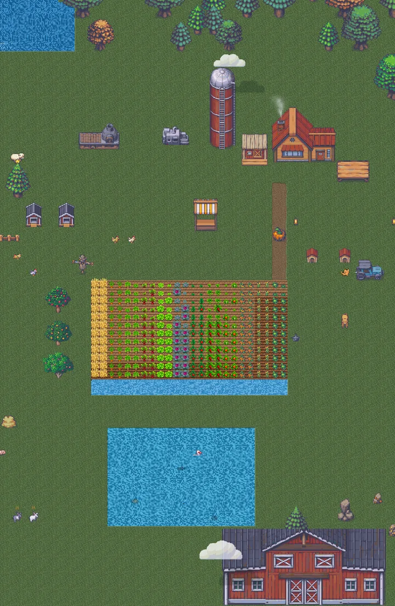

Stock Farmer is a farming game for iPhone, iPad and Android. You grow crops, raise animals, mine ore, build workshops, go fishing, craft goods, and play the Stock Market with farm gold at real market prices.

This wiki lists every crop, building, animal, fish, material and recipe, and the rules, formulas and odds behind them.

## Play the beta

| Platform | How to join |
| --- | --- |
| iPhone and iPad | Join the public TestFlight beta at [testflight.apple.com/join/u5btwEub](https://testflight.apple.com/join/u5btwEub). |
| Android | 1. Join the [beta testers' Google Group](https://groups.google.com/g/stock-farmer-android-beta-testers). 2. Opt in on [Google Play](https://play.google.com/apps/testing/com.hunterttp.stockfarmer). 3. Install the game from the [Play Store](https://play.google.com/store/apps/details?id=com.hunterttp.stockfarmer). |
