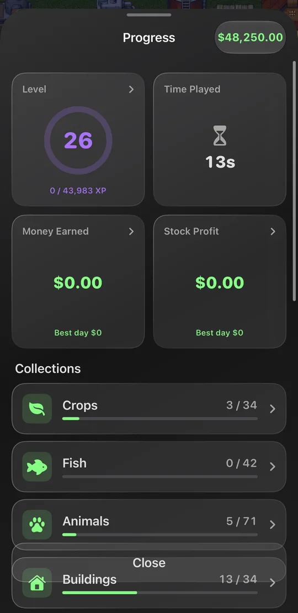

The Progress menu shows how far your farm has come: your level, time played, money, and a collection for everything there is to find. Tap the level panel in the corner to open it.

## The cards

| Card | Shows | Opens |
| --- | --- | --- |
| Level | Your level, with a ring for the XP toward the next one | The Level page |
| Time Played | How long you have played this farm | Nothing |
| Money Earned | Everything you have earned, with your best day | A page with a chart and the best day |
| Stock Profit | What your stock sales have made or lost, with your best day | A page with a chart and the best day |

- The **Level** page shows your XP toward the next level, an XP chart, Total XP, Time played, Crops harvested (fruit trees included) and Quests completed.
- **Money Earned** counts every sale plus the profit of each winning stock sale. Spending, refunds and stock losses never take it down.
- **Stock Profit** counts wins and losses together. See [Stock Market](../stock-market/).
- Every chart is over time played. It adds a point for each 5 minutes of play in which the number moved, and keeps at most 300 points.

A **Perfection** card at the bottom shows the percent of everything tracked that you have collected.

## Collections

Under **Collections**, each row shows how many entries you have found. Tap a row to open it.

| Collection | An entry is collected when you | Grouped by |
| --- | --- | --- |
| Crops | Plant it | None |
| Fish | Catch one (the heaviest catch is kept) | Rarity |
| Animals | Chickens, hens and roosters: raise one until it grows up (or collect an egg from one). Livestock: gather from one, or sell it (ducks). Pets: move one in. | Chickens, each livestock animal, Pets |
| Buildings | Build one. Upgrade levels of animal homes are collected too. | Buildings, Building Upgrades |
| Decorations | Place one. Every tree color at every size is collected when you plant it at that size. | Decorations, each tree kind |
| Terrain | Lay a tile (grass, farmland, each water style, each ground cover), break a rock or mine an ore vein | Tiles, Rocks, Ore Veins |
| Recipes | Finish one at a workshop | Workshop |
| Environment | See a season, catch a butterfly of each wing color, catch a firefly of each glow, and see rain and snow | Seasons, Butterflies, Fireflies, Weather |
| Tools | Reach each upgrade level of a tool (level 1 is yours from the start) | Tool |

- Collected entries show in full color with a green check. The rest show as silhouettes.
- Moving a building or decoration does not count as placing it.
- Each collection page shows "x of y collected" with a bar, a search box and a filter menu: **All**, **Collected** or **Not yet**.
- A tool's level shows in white at level 1, purple at level 2 and orange at level 3.

## How-to hints

Tap any entry to see how to collect it.

- An entry you have not collected says what to do: the level it unlocks at (and your current level), the building or tool you need, what it costs and where to get it.
- An entry you have collected says what you did, such as "Done: you have planted Wheat."
- A hint for an entry that needs time or luck, such as a rare fish or a colored firefly, says how often to expect it in words.

## Related pages

- [Levels](../levels/)
- [Quests](../quests/)
- [Butterflies and Fireflies](../gathering/butterflies-and-fireflies/)
- [Seasons](../world/seasons/)
