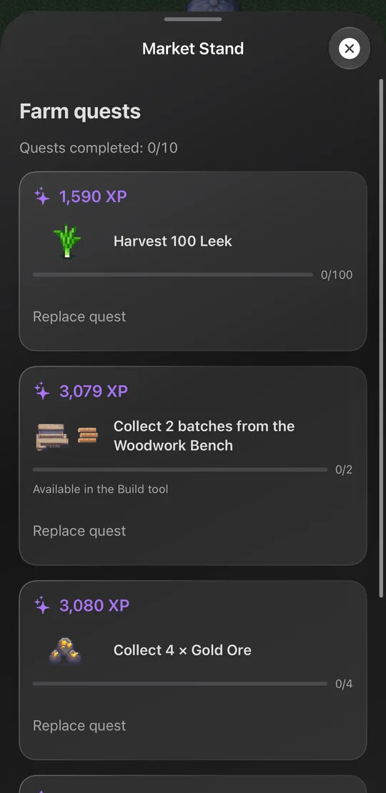

import Fact from '../../components/Fact.astro';

The Market Stand offers optional quests that pay XP. The stand unlocks at level <Fact path="quests.marketStandLevel" />. See [Market Stand](../buildings/market-stand/).

Tap the Market Stand to see its quests. Each quest card shows its XP reward, what it asks for and a progress bar for each part.

## How quests work

- The stand shows <Fact path="quests.marketStandQuests" /> quests at once.
- Progress counts on its own as you play. A finished quest pays its XP on its own, and a new quest takes its place.
- **Replace quest** swaps a quest for a new one. It is free and quests have no deadline, but the quest's progress is lost.
- Quests are sized to your level. Harvest quests ask for more as your farmland grows, up to <Fact path="quests.mostCropsAsked" /> of a crop.
- At the maximum level quests show "Maximum level" in place of an XP reward and pay no more XP.

## Kinds of quest

| Kind | Asks you to | Unlocks |
| --- | --- | --- |
| Harvest | Harvest an amount of a crop you unlocked at least a few levels ago | From the start |
| Workshop | Collect batches from a workshop you have unlocked | With the workshop |
| Feed favorites | Hand-feed favorite foods (Wheat) to animals from a chicken or livestock home you have unlocked | With the home |
| Collect | Collect eggs, milk, goat milk, wool or fertilizer from your animals | Eggs from level 5, others with their animal |
| Plant trees | Plant trees or fruit trees | From the start |
| Stock profit | Earn profit in the [Stock Market](../stock-market/) | Level <Fact path="quests.stockQuestsFromLevel" /> |
| Ore | Collect ore, bars or cut gems | Level <Fact path="quests.oreQuestsFromLevel" /> |

- From level <Fact path="quests.stockQuestsFromLevel" />, the stand always has one stock quest. Replacing it brings another stock quest.
- Ore quests ask for the ore itself, or for a bar or cut gem made from it. See [Mining](../gathering/mining/).

## XP rewards

A quest pays XP in proportion to your level and the work it takes. The same quest pays more at a higher level, and a bigger quest pays more.

## The upgraded Market Stand

An **Upgrade** row appears in the stand once you have completed <Fact path="quests.questsToUpgrade" /> quests. The upgrade costs <Fact path="quests.upgradeCost" as="money" />.

| | Market Stand | Upgraded Market Stand |
| --- | --- | --- |
| Quests at once | <Fact path="quests.marketStandQuests" /> | <Fact path="quests.upgradedQuests" /> |
| Quest size | One part | Harder, most with two parts, for more XP |

Until you reach the number, the stand shows "Quests completed: n/<Fact path="quests.questsToUpgrade" />". Quests you already had stay on the board when you upgrade.

## Related pages

- [Market Stand](../buildings/market-stand/)
- [Stock Market](../stock-market/)
- [Levels](../levels/)
- [Progress](../progress/)
