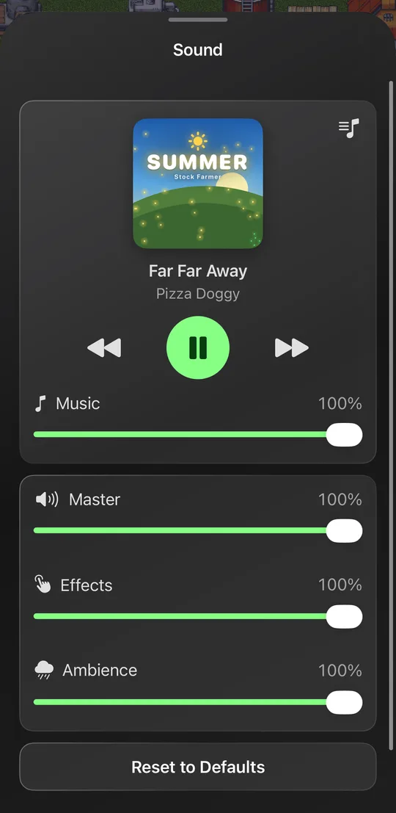
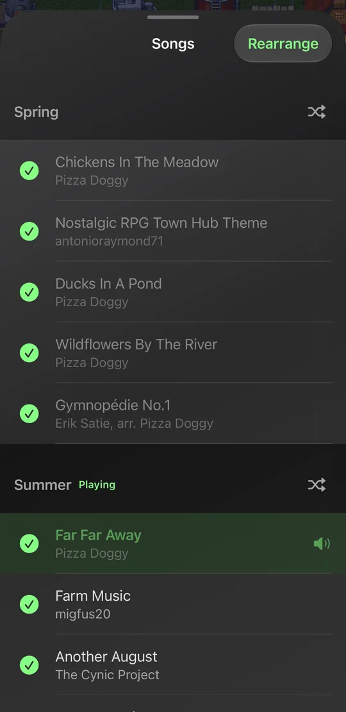

Music and sound are set on the Sound page of [Settings](../settings/).

## Seasonal music

Each season has its own songs, played in order and wrapping back to the first after the last. A season starts on its first song that is turned on. When the season changes, the music changes to the new season's songs.

- Music starts as the game opens and keeps playing under the farm list and across a change of farm.
- With no farm open, it plays the season of the last farm played. On a first launch it plays Spring.
- Music pauses while the game is in the background.
- Music gets quieter under the level-up, quest and all-crops-ready fanfares.

### Songs by season

Songs are listed in their starting order. Songs with no artist named below are from Cozy Tunes by Pizza Doggy.

| Spring | Artist |
| --- | --- |
| Chickens In The Meadow | Pizza Doggy |
| Nostalgic RPG Town Hub Theme | antonioraymond71 |
| Ducks In A Pond | Pizza Doggy |
| Wildflowers By The River | Pizza Doggy |
| Gymnopédie No.1 | Erik Satie, arr. Pizza Doggy |

| Summer | Artist |
| --- | --- |
| Far Far Away | Pizza Doggy |
| Farm Music | migfus20 |
| Another August | The Cynic Project |
| Forgotten Biomes | Pizza Doggy |
| Sunset Plains | Yoiyami |
| Costal Town | Hitctrl |
| What Clouds Are Made Of | Pizza Doggy |
| Evening Harmony | Pizza Doggy |

| Fall | Artist |
| --- | --- |
| Memories of a Lost Autumn | Jonathan Shaw |
| Sunlight Through Leaves | Pizza Doggy |
| Drifting Memories | Pizza Doggy |
| Autumn | maou |
| Path to Lake Land | Alexandr Zhelanov |
| Gentle Breeze | Pizza Doggy |

| Winter | Artist |
| --- | --- |
| Winter is Coming | KipperFalcon |
| Polar Lights | Pizza Doggy |
| Sleep & Snow | Tsorthan Grove |
| Floating Dream | Pizza Doggy |
| No More Magic | HorrorPen |
| Wanderer's Tale | Pizza Doggy |
| Wind Over The Trees | Pizza Doggy |
| The Fallen | Jonathan Shaw |
| Calm Ambient 2 (Synthwave 15k) | The Cynic Project |

The full credits, with licences and links, are in Settings → About → Credits.

## Now Playing card

The Sound page opens with a card that works like a music app.

| Part | What it does |
| --- | --- |
| Cover, title and artist | Shows the song playing. The cover changes with the season of the music (see below). With the music at 0% it says Music off. |
| Previous | Goes back one song in the season's list, wrapping from the first to the last. |
| Play or Pause | Pauses the music where it is until played again. A pause lasts until the game is closed. |
| Next | Skips to the next song. |
| Music slider | Sets the music's volume. |
| Song list button | The music list icon in the top right corner. Opens the song list. |

Previous and Next play a song even while paused. All three buttons are greyed out while the music is at 0%.

### Album covers

Each season has its own cover, in the style of the season-change title. The season's icon and name glow in its color over the farm's hills, sky and weather.

| Season | Cover |
| --- | --- |
| Spring | Petals in the air |
| Summer | Sunlight |
| Fall | Leaves |
| Winter | Snow, with the hills under snow |

- The cover follows the season of the song playing. When the music crosses into the next season, the new cover fades in.

## Song list

The song list shows each season as a heading with its songs below it in play order. The season playing is marked Playing, and the song playing is highlighted with a speaker.

| To do this | Do this |
| --- | --- |
| Play a song | Tap a song in the season playing. It plays at once and the order carries on after it. |
| Leave a song out | Uncheck its check mark. Every song is checked at the start. If it is playing, the next song that is on plays. |
| Play a season in random order | Tap the shuffle button at the right of the season's heading. It is off at the start. A shuffled season uses a fresh random order each time its music starts and each time every song has played. |
| Change the order | Tap Rearrange, drag songs by their handles, then tap Done. A song dragged under another season's heading moves to that season and plays there. |
| Go back to the first arrangement | Tap Reset to Default and confirm. Every song returns to its first season and place, every song is turned on and shuffle is off. |

Each season keeps at least one song turned on. Unchecking or moving away a season's last song that is on is refused with a note such as "Spring needs at least one song turned on." The arrangement is the same for every farm. Reset to Defaults on the Sound page also resets it.

## Sound effects and volume

Volume sliders run from 0% to 100%.

| Slider | What follows it |
| --- | --- |
| Master | Every sound. |
| Music | The songs. |
| Effects | Buttons, menus, shops, planting, building, destroying, cooking, fishing, selling, fanfares, animal voices and petting. |
| Ambience | Rain, thunder, crickets, birdsong, the midnight chime and the season change sound. |

- There are no on or off switches. A volume of 0% turns a kind of sound off.
- Letting go of a slider plays a short sample of its sound.
- Haptic feedback has no setting in the game.

## Ambient sounds

- Rain plays during a shower and swells and fades with the rainfall.
- Thunder rolls during showers. Winter's snow brings none.
- Crickets sing through the night in Spring, Summer and Fall, and are silent in Winter. They fade under rain.
- Birds chirp from time to time. A chime sounds at midnight.

See [Weather](../../world/weather/) and [Day and night](../../world/day-and-night/).
