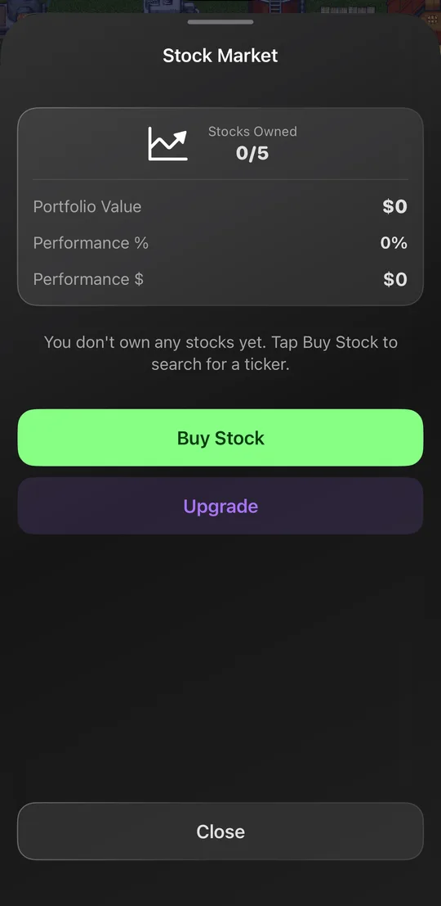

import Fact from '../../components/Fact.astro';

The Stock Market is a pretend market inside the game. You buy and sell shares with farm money at real market prices, but no real stocks or real money are involved.

The House opens it. The House unlocks at level <Fact path="buildings.house1.unlockLevel" />. See [House](../buildings/house/).

## Opening the market

- Tap the House to open the Stock Market.
- It needs an internet connection. Offline, it shows "No internet connection" and the rest of the farm keeps working.
- The top card shows **Stocks Owned** (slots used out of slots available), **Portfolio Value**, **Performance %** and **Performance $** against what the shares cost.
- Each stock you own is a row with its ticker, price, today's change against yesterday's close (a green up or red down arrow), how many shares you own, what they are worth and your average cost.

## Buying and selling

1. Tap **Buy Stock** and type a ticker, such as AAPL. Tap **Search**.
2. Tap **Buy** on its row.
3. Choose how many whole shares. The screen shows the price each and the total.
4. Tap **Buy**. The total comes out of your money.

To sell, tap **Sell** on a stock you own, choose a number of shares, and tap **Sell**. The total goes into your money.

- You can buy as many shares as your money covers.
- Buying more of a stock you own changes your average cost.
- A sale shows its **Profit / loss**: what the shares sold for above or below their average cost. Buying shows no profit or loss.
- A trade is made at the price on screen.

## Slots

Each different stock you own takes one slot. More shares of the same stock take no more.

| House | Stocks you can own |
| --- | --- |
| House | <Fact path="world.stockSlots" /> |
| Luxury House | <Fact path="world.stockSlotsUpgraded" /> |

Selling every share of a stock frees its slot. The **Upgrade** button in the Stock Market turns the House into the Luxury House for <Fact path="home-upgrades.house.cost" as="money" />. It unlocks at level <Fact path="home-upgrades.house.unlockLevel" />.

## Prices

- Prices come from a real market source and can be delayed.
- While the Stock Market is open, the prices of the stocks you own update every <Fact path="world.stockRefreshMinutes" /> minutes. A search looks up its price when you tap Search.
- Prices do not update while the menu is closed. A trade screen shows when its price was fetched ("As of ...").
- Between updates, the price moves by a small amount.

## Profit and quests

- Each sale is recorded with the farm. Winning sales add to **Money Earned** in [Progress](../progress/). **Stock Profit** there counts wins and losses together and shows your best day.
- From level <Fact path="quests.stockQuestsFromLevel" />, every Market Stand carries a stock quest that reads "Earn $N profit in the Stock Market". Each whole dollar of profit counts. Losses take nothing back. See [Quests](../quests/).

## Related pages

- [House](../buildings/house/)
- [Quests](../quests/)
- [Progress](../progress/)
- [Storage and Selling](../storage-and-selling/)
