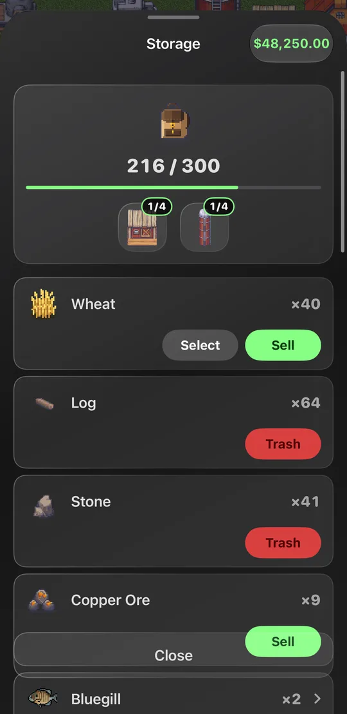

import Fact from '../../components/Fact.astro';

Storage holds what you gather: crops, fruit, eggs, logs, stones, ore, fish and more. Everything goes into storage unless a tool is set to sell it on the spot. Storage holds a fixed number of items, all kinds counted together.

## Room

| Source | Adds | Unlocks at level | Cost | Materials |
| --- | --- | --- | --- | --- |
| Backpack | <Fact path="world.backpackSlots" /> slots | From the start | | |
| Shed | <Fact path="buildings.shed.storageAdded" /> slots each | <Fact path="buildings.shed.unlockLevel" /> | <Fact path="buildings.shed.cost" as="money" /> | <Fact path="buildings.shed.logs" /> Logs, <Fact path="buildings.shed.stones" /> Stones |
| Silo | <Fact path="buildings.silo.storageAdded" /> slots each | <Fact path="buildings.silo.unlockLevel" /> | <Fact path="buildings.silo.cost" as="money" /> | <Fact path="buildings.silo.logs" /> Logs, <Fact path="buildings.silo.stones" /> Stones |

- You can build up to <Fact path="world.storageBuildingLimit" /> Sheds and up to <Fact path="world.storageBuildingLimit" /> Silos.
- Only the Shed and the Silo add room. Barns, the Stable and trunks add none.
- The Silo comes in two looks, Tower and Tower and Shed. See [Buildings](../buildings/).
- A Shed or Silo can only be destroyed while the remaining storage still holds everything stored.

## Storage menu

1. Tap the circle in the bottom-left corner. A ring of buttons opens.
2. Tap Storage.

The menu shows:

- Items stored out of total room, with a bar. The count turns red when storage is full.
- A picture of the Shed and of the Silo under the bar. Each is grey until its level is reached, then full color with a count of how many are built out of the most allowed, such as "0/4". The count turns gold at the limit. Tap a picture to open that building's page.
- Money in the top-right corner and a Close button at the bottom.
- One row for each kind of item, with its count, in the order the items unlock.

Each row can have up to three buttons:

| Button | Appears on | What it does |
| --- | --- | --- |
| Select | Decorations, fences, fertilizer, butterflies, fireflies and any food other than fish | Equips the item for use on the farm (see below). |
| Sell | Anything worth money | Opens a page to pick how many, showing the price each and the total. Fewer, More, Max and a slider set the amount. |
| Trash | Logs and stones | Throws some away for nothing. |
| Release | Butterflies and fireflies | Lets some go for nothing. |

Logs and stones sell for nothing and can only be trashed. Everything else with a price can be sold, and fish are sold one by one (see below).

## Fish in storage

Fish are kept one by one, each with its own weight, number and name (see [Fishing](../gathering/fishing/#your-fish)).

- A kind of fish has one row with its name, rarity badge, count and what all of that kind are worth together. The row has no buttons: tap it to open the list of that kind's fish right under it, and tap it again to close the list. The list is not split into groups and shows the newest catch first (a fish you let go and catch again counts as new). Each fish shows its name or number, weight, size and price, with two buttons.

| Button | What it does |
| --- | --- |
| Sell | Sells that fish for its own price. |
| Rename | Gives the fish a name, or changes it. |

- Picking a kind of fish from the Decorate tool's list holds its heaviest fish. The dropdown shows the name of the fish held.

## Selling

Sell from the Storage menu, or gather with a tool set to Sell.

- The Scythe and the Bucket each have a Store or Sell dropdown beside their name in the Harvest tool.
- With Sell set, what the tool gathers is sold the moment it is gathered, at the usual price. It does not need storage room.
- With Store set, it goes into storage to sell later.
- The Axe, the Pickaxe and the Fishing Rod always store.
- On a new farm the Scythe and the Bucket start on Sell.

## Select

Select picks up an item and closes the menu. The item then comes out of storage as you use it.

- **Decorations and fences:** the Decorate tool holds the item. Each one set down uses one from storage and costs no money. A sprinkler goes to the Fertilize tool.
- **Fertilizer:** the Fertilize tool fertilizes a tile for each fertilizer used.
- **Food:** drag it onto an animal to hand-feed it. A fish fed this way is the one held. Every crop and fruit basket, every fish, eggs, milk, goat milk, flour, bread, cheese and goods made from food count as food. See [Feeding](../animals/feeding/).
- **Fish:** pick the fish in the Decorate tool, then tap or drag over free water.
- **Butterflies and fireflies:** set them free on the farm. Fireflies can only be set free at night.

The tool's dropdown shows how many of the item are left, for example "King Salmon (x3)". When they run out it shows (x0) in red and the item stays selected. Picking something from a shop list again buys it as before.

## Taking decorations down

The Axe takes a decoration down in one pass and puts it into storage, one entry for each decoration and size. A rock is broken with the Pickaxe instead. A stored decoration sells for what destroying it would refund, which is <Fact path="terrain.refundPercent" />% of its price.

## When storage is full

- Gathering into storage stops and the game says "Storage is full". A tool set to Sell still works.
- A workshop keeps its finished goods until the Bucket can take them.
- The Tractor's Store button moves as many as fit and leaves the rest aboard.
- Selling or trashing frees room.
