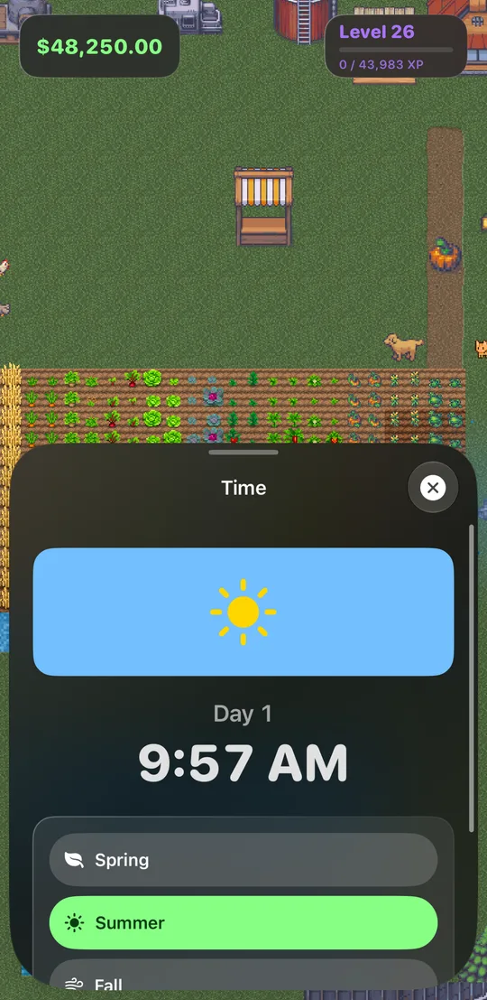

import Fact from '../../../components/Fact.astro';

The farm has its own clock. A real second is a minute on it, so one farm day lasts <Fact path="world.realSecondsPerFarmDay" as="duration" /> of play. A new farm starts at 8 AM.

## The clock

- The clock button on the tool ring shows a sun or a moon and the time, such as 9:05 PM.
- Tap it to open the Time sheet. It shows the day (Day 1, Day 2 and so on), the time, a sky picture that matches the time and a button for each season. See [Seasons](../seasons/).
- The sky picture is light blue by day, orange at dawn and dusk, deep blue with the moon at night and grey with a rain cloud while it rains.
- The farm stays in view and can still be panned while the Time sheet is open.
- The clock only runs while the game is open. When you open a farm, the clock reads what it read when you left.
- Crops, animals, workshops and trees carry on in real time, whatever the farm clock says. The clock decides the light, the weather and when animals shelter.

## Night

Night lasts from 9 PM to 5 AM. It gets dark smoothly and light again the same way.

| Farm time | How dark |
| --- | --- |
| Before 8 PM | Day |
| 8 PM to 9 PM | Getting darker |
| 9 PM to 4:30 AM | Fully dark |
| 4:30 AM to 5:30 AM | Getting lighter (half dark at 5 AM) |
| After 5:30 AM | Day |

At night:

- The farm is tinted a soft blue.
- Water glows faintly cyan.
- Windows light up, and so do Lanterns, doorways and Christmas lights. See [Lanterns and Lights](../../decorations/lanterns-and-lights/).
- Animals that live in a building go home. See [Weather](../weather/).
- Fireflies come out. Each night <Fact path="world.firefliesPerNight" /> fireflies come out of the forest and drift toward the middle of the farm. See [Butterflies and Fireflies](../../gathering/butterflies-and-fireflies/).
- Past the edge of the map, a starry space backdrop fades in over the plain green background as it gets dark and fades out in the morning.

## Sounds of the day

| Sound | When |
| --- | --- |
| Bird calls | By day, when it is not raining, now and then |
| Crickets | On Spring, Summer and Fall nights, swelling as it gets dark and fading around dawn. Winter nights are silent. |

Both follow the Ambience volume in Settings → Sound.

## Midnight

At midnight on the farm's clock, the day ends and the next one begins.

- A slow wave of glowing pixels fades in and rolls out in all directions from the middle of the screen. It takes about 20 real seconds to leave the far corner of the map behind.
- The wave lights plain grass only. Its colors follow the season. See [Seasons](../seasons/).
- A soft chime rings with the wave, and the music fades out for it and back in afterwards.
- The wave grows new trees, rocks and ore veins. See [Wild Growth](../wild-growth/).
- With Reduce Motion on, the wave is not drawn. The new day, the chime and the growth still happen.

The day counts and the chime rings only while the game is open. A midnight that passes while the game is closed does not count. Opening the game in the middle of the wave does not start a new day.

## Day summary

A few seconds into the chime, a banner fades in near the top: **Day N has begun!**

- It lists what you sold the day before, one row per kind of item, biggest earner first, with its picture, name, how many and what they earned.
- A total sits under the list. It reads "Nothing was sold yesterday" if you sold nothing.
- Sales are crops and other items sold from Storage or on the spot. Trash and refunds for fences, decorations and buildings are not sales.
- The banner goes away after 12 seconds, when you tap it, or at once with the X in its corner.
- The tally starts again from zero after each summary.

## Related pages

- [Seasons](../seasons/)
- [Weather](../weather/)
- [Wild Growth](../wild-growth/)
- [Storage and Selling](../../storage-and-selling/)
