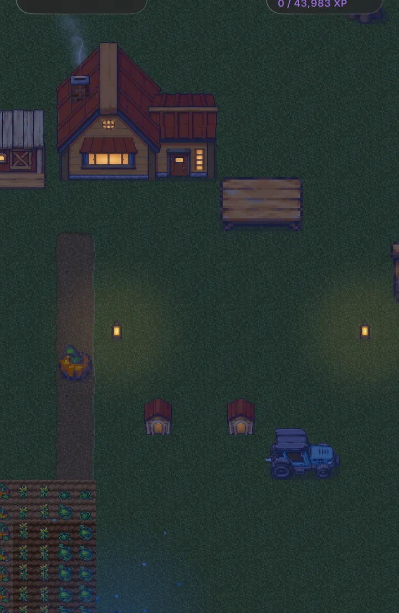

import DataTable from '../../../components/DataTable.astro';
import Fact from '../../../components/Fact.astro';

The farm has its own clock. A real second is a minute on it, so one farm day lasts <Fact path="world.realSecondsPerFarmDay" as="duration" /> of play. A new farm starts at <Fact path="world.newFarm.startTime" /> on day 1.

## The clock

- The farm's clock runs only while the game is open. When you open a farm, the clock reads what it read when you left.
- Crops, animals, workshops and fish timers carry on in real time, whatever the farm's clock says.
- The clock decides the light, the rain, the seasons, the fireflies, when animals shelter and when wild fish swim away.

| Farm time | Real time |
| --- | --- |
| 1 minute | 1 s |
| 1 hour | 1 min |
| 1 day | <Fact path="world.realSecondsPerFarmDay" as="duration" /> |
| 1 season (<Fact path="world.daysPerSeason" /> days) | <Fact path="world.dayNight.seasonRealSeconds" as="duration" /> |
| 1 year (<Fact path="world.dayNight.seasonCount" /> seasons) | <Fact path="world.dayNight.yearRealSeconds" as="duration" /> |

## Night

Night lasts from <Fact path="world.dayNight.fullDarkStart" /> to <Fact path="world.dayNight.morningHalfDark" />. It gets dark smoothly and light again the same way.

<DataTable name="darkness-timeline" />

What darkness changes:

| Effect | When |
| --- | --- |
| Animals with a home go inside | From <Fact path="world.dayNight.shelterDarknessPercent" />% dark: <Fact path="world.dayNight.eveningHalfDark" /> to <Fact path="world.dayNight.morningHalfDark" /> |
| Fish arrive sooner | The wait for the next fish shortens with the dark, by <Fact path="fish.spawning.nightWaitReductionPercent" />% at full night (see [Fishing](../../gathering/fishing/#when-fish-appear)) |
| Butterflies | Only in full daylight |
| Fireflies | <Fact path="world.fireflies.windowStart" /> to <Fact path="world.fireflies.windowEnd" /> (see [Butterflies and Fireflies](../../gathering/butterflies-and-fireflies/#fireflies)) |
| Windows, lanterns and lights glow | At night and in the rain. Looks only. |
| Ponds and water reflect the starry sky, and swimming ducks send ripples across it | Fades in from 8:35 PM to 9:35 PM, stays overnight, and fades out from 4:00 AM to 5:00 AM. Looks only. |
| Northern lights over the farm | Winter nights only (see [Winter aurora](#winter-aurora)). Looks only. |
| Nighttime UFO visits | Rare clear nights, 9 PM to 3 AM, on farms with grown cows (see [Livestock](../../animals/livestock/#nighttime-ufo-visits)) |

## Winter aurora

On every winter night the northern lights shine over the whole farm.

- It comes out at <Fact path="world.dayNight.auroraStart" /> and is gone by <Fact path="world.dayNight.auroraEnd" />.
- Each night has its own colours, from <Fact path="world.dayNight.auroraPalettes" /> sets of greens, teals and blues. Two nights in a row never share colours, and a farm shows the same colours on every device.
- Three bright ribbons of light cross the farm at a slant. Their lower edges roll in big, slow waves, and straight rays stream up from them.
- The ribbons cast a faint glow on the ground under them. Ponds and lakes keep their stars and do not mirror the aurora.
- With Reduce Motion on, the aurora holds still.

## Midnight

At midnight on the farm's clock the day ends and the next one begins.

- A wave of light rolls out over the map for about <Fact path="world.dayNight.midnightWaveSeconds" as="duration" />. As it passes each tile, wild trees, rocks and ore veins grow and appear (see [Wild Growth](../wild-growth/)).
- The day counts, and the wave grows things, only while the game is open at midnight. A midnight that passes while the game is closed does not happen, and opening the game in the middle of the wave does not start a new day.

## Day summary

At the start of each day, a summary lists what you sold the day before: each kind of item, biggest earner first, with how many and what they earned, and the total.

- Sales are crops and other items sold from Storage or on the spot, and ducks sold.
- Trash and the refunds for destroyed buildings, decorations and fences are not sales.
- The tally starts again from zero after each summary.

## Related pages

- [Seasons](../seasons/)
- [Weather](../weather/)
- [Wild Growth](../wild-growth/)
