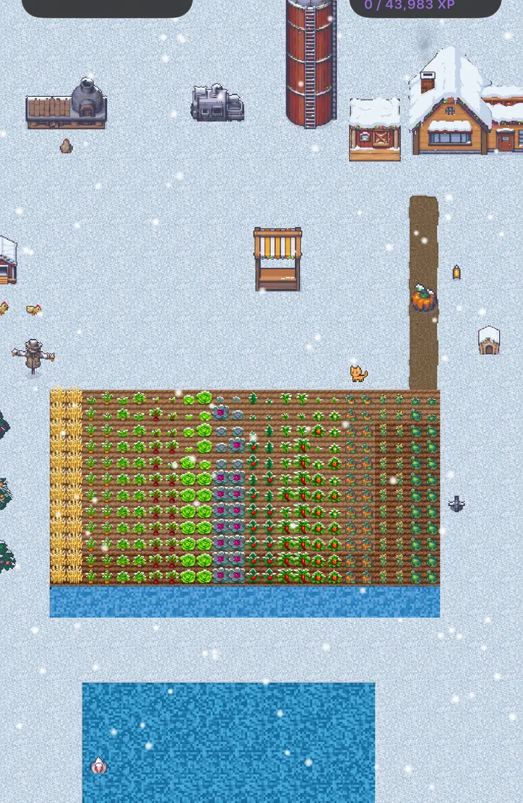
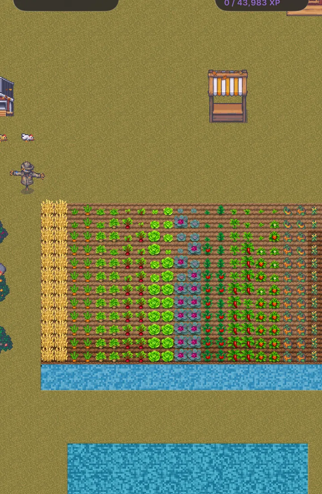

import Fact from '../../../components/Fact.astro';

The year runs Spring, Summer, Fall and Winter, then starts again. Each season lasts <Fact path="world.daysPerSeason" /> farm days. A new farm starts on day 1 of the Starting Season you pick when you make it, Spring unless you change it.

## What a season changes

Crops, animals, prices, fish and every other rule are the same in every season. A season changes only these:

| | Spring | Summer | Fall | Winter |
| --- | --- | --- | --- | --- |
| Weather | Rain 2 PM to 5 PM | Rain 2 PM to 5 PM | Rain 2 PM to 5 PM | Snow all day, heavier 2 PM to 5 PM |
| Thunder | Yes | Yes | Yes | No |
| Butterflies | Yes | Yes | Yes | None |
| Night crickets | Yes | Yes | Yes | None |
| Looks | Spring grass, wildflowers, petals on the wind, all trees a lively green | The original look, little grass tufts, all trees green | Autumn foliage, leaves on the wind, fallen leaves on the grass, thickest under oaks and birches | Snow on the ground, trees, roofs, fences and rocks |
| Music | Its own songs | Its own songs | Its own songs | Its own songs |

Animals shelter at the same times in Winter as in other seasons: at night and in the 2 PM to 5 PM storm. See [Weather](../weather/).

## When a season turns

- The next season comes on the morning after the current one's last day, at <Fact path="world.seasonTurnsAtHour" /> AM on the farm's clock.
- The farm's clock stands still while the game is closed (see [Day and Night](../day-and-night/)), so seasons only pass while you play.
- A season that comes due while a menu, a level-up, the day summary or fishing is on screen turns once that is closed.
- A season can also be picked by hand from the clock. It changes at once and lasts its full <Fact path="world.daysPerSeason" /> days from that day.
- A new farm opens with its first season sweeping in over it, and the tutorial starts once the season's title has gone.
- Each season counts as seen in [Progress](../../progress/) the first time it plays.

## Related pages

- [Weather](../weather/)
- [Day and Night](../day-and-night/)
- [Butterflies and Fireflies](../../gathering/butterflies-and-fireflies/)
