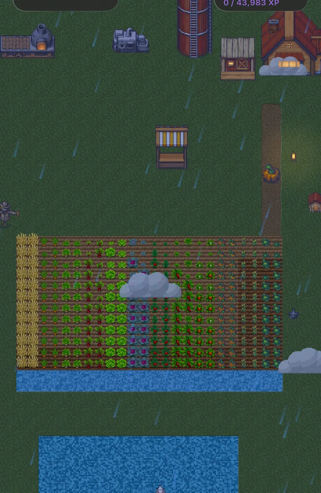

import Fact from '../../../components/Fact.astro';

Weather changes how the farm looks and sounds and where animals stay. It never changes how crops grow or what anything sells for.

## Rain and snow

It rains every day from 2 PM to 5 PM on the farm's clock. That is 3 hours of the farm's clock, or <Fact path="world.rainRealMinutes" /> real minutes.

- The rain builds up over the first 20 minutes of the farm's clock and dies away over the last 20.
- The farm is tinted a little darker and cooler while it rains. Blue streaks fall at a slant that follows the wind. The same rain falls over the fishing water.
- A steady rain sound plays and swells and fades with the picture. It follows the Ambience volume in Settings → Sound.
- Windows light up in the rain, and butterflies stay away.
- In Winter snow falls instead of rain, and it never stops. It falls lightly day and night, and builds to a full storm in the rain hours. Snow is silent.

| | Spring, Summer, Fall | Winter |
| --- | --- | --- |
| Falls | Rain, 2 PM to 5 PM | Snow, all day and night |
| Full strength | Most of the shower | The rain hours |
| Sound | Rain loop | None |
| Thunder | Yes | No |

Seeing rain and snow for the first time counts in [Progress](../../progress/).

## Thunder

Thunder rolls now and then through every rain shower in Spring, Summer and Fall.

- A roll comes about every minute while it rains hard enough, in four different recordings from near to far. It is never the same one twice in a row.
- Every roll is loud enough to hear clearly over the rain.
- Lightning is rare. Only an occasional shower brings a few soft flashes across the farm, each just before a roll.
- Flashes do not show with Reduce Motion on or Weather effects off. The thunder still plays.
- Thunder follows the Ambience volume. It fades out when the rain stops.

## Animals sheltering

Animals that live in a building go home when it is night or raining hard. See [Day and Night](../day-and-night/) for the night hours.

- They go in once it is half dark, or once the rain is half built up (10 minutes in), and come out when the night or rain is over.
- Ducks on ponds have no building and stay out.
- An animal inside is hidden and cannot be tapped. It does nothing for the farm meanwhile: a hen lays no eggs, and a cow, sheep or goat cannot be milked or shorn.

## Wind

The wind blows one way for a spell, then may change direction. Its direction is settled every 5 real minutes.

- A gust comes every 30 seconds. It leans the trees and chimney smoke and turns weathercocks. A few curls of wind drift across the screen.
- Rain, snow and clouds lean or drift the way the wind blows.
- In Fall, now and then a gust carries tumbling leaves across the screen, and in Spring flower petals. They are left out in the rain.

## Floating clouds

Six soft, slightly see-through pixel-art clouds drift smoothly over the farm with the wind, each casting a soft shadow on the ground a couple of tiles away.

- The clouds belong to the map. They move with the ground as you drag and zoom, and only the wind moves them over it.
- They are already there when the farm opens, and there are always six on the map. As one starts to fade out over the far side, a new one starts to fade in at the edge the wind blows from. If the wind turns before the swap is done, the old one drifts back and the new one fades away.
- They show only over the map and fade in and out at its edge.
- In the rain they turn grey, hurry along and cast no shadows. In Winter they are a cool blue-grey under white tops, so they stand out over the snow. At night they sit under the night tint with a pale moonlit rim.
- They hide when you zoom in closer than the zoom the farm opens at. They fade out in a moment, keep drifting and fade back in when you zoom out to that zoom or further.
- They never take a tap. They hold still with Reduce Motion on.

## Graphics switches

Settings → Graphics has two switches for weather. Both are on to start with, and Reset to Defaults turns them back on.

| Switch | Off |
| --- | --- |
| Weather effects | No rain or snow, no rain tint, no falling leaves or petals, no curls of wind. Anything in the air goes at once. The weather still happens: animals still shelter, the rain still sounds and windows still light up. |
| Clouds | Every cloud and shadow goes at once. Works on its own, apart from Weather effects. |

## Related pages

- [Seasons](../seasons/)
- [Day and Night](../day-and-night/)
- [Music and Sound](../../settings/music-and-sound/)
- [Settings](../../settings/settings/)
